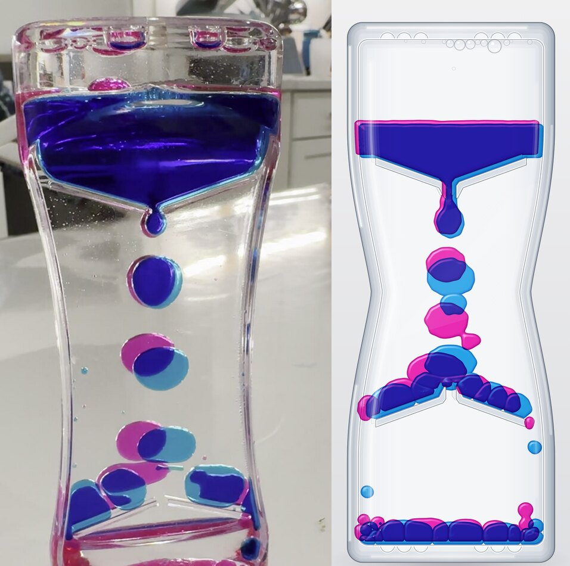
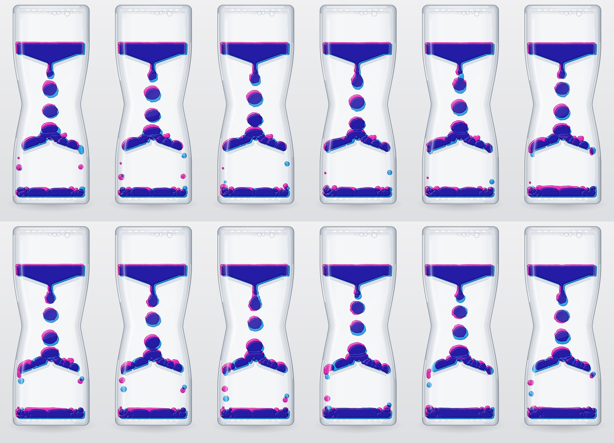
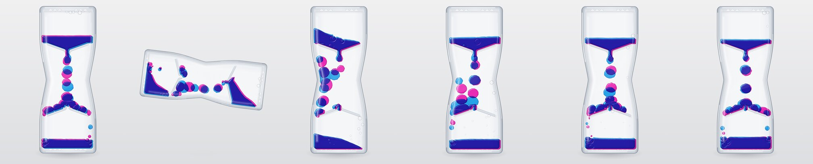

# Liquid hourglass

A double liquid-motion hourglass in the browser: two sealed chambers of magenta and cyan liquid dripping through clear oil, driven by a particle fluid simulation rather than scripted animation. Tap it to turn it over.

Left: the real toy. Right: the simulation.

## Running it

No build step and no dependencies. Open `index.html` directly, or serve the folder.

- Tap or click the hourglass to turn it over. Tapping the left half turns it anticlockwise, the right half clockwise. `F` also flips.
- **Pause / Play** stops and resumes time. `P` or space does the same.
- **Flip when empty** turns it over automatically a few seconds after the last drop, so it can be left running.
- With reduced motion requested, the page starts paused with a Play button.

URL options: `?debug` shows the raw particle fields and a timing readout, `?still` starts paused, `?seed=N` changes the random seed, `?main` runs the simulation on the main thread instead of in workers.

## How it works

Each chamber is its own simulation of about 2,100 equal-volume particles, solved with position based fluids at 240 steps per second. The two chambers never interact; they are only drawn over each other.

The cell is modelled as a thin gap of varying depth. The end chambers are four times deeper than the slot between them, so liquid that leaves the reservoir spreads into a wide flat disc in the slot and shrinks back into a small bead when it reaches the other end. That one assumption is what makes the falling drops large and the beads in the pool small, as they are in the real toy.

I considered grid methods (lattice Boltzmann, phase field) and rejected them for two reasons. With surface tension this strong relative to gravity they need time steps far too small for real time, and a single grid field has no way to keep two drops separate once they touch, which is most of the character of this toy. Particles conserve volume exactly and let each body of liquid carry an identity.

Rendering is WebGL. Particles are splatted into a field, the field is smoothed and thresholded into crisp shapes, and the two chambers' colours are multiplied over the glass like stacked filters. Touching blobs are drawn in separate channels so each keeps its own outline. The glass body is drawn once with Canvas 2D.

## What matches the footage

Twelve consecutive frames at 12 fps, for comparison with `reference/drip-sequence-12fps.jpg`.

| | Footage | Simulation (first 15 s of a run) |
|---|---|---|
| Drop width | about 0.2 of the body width | 0.19 |
| Interval between drops, per chamber | 0.4 to 0.5 s | 0.40 s |
| Time to cross the middle section | a bit over a second | 1.2 s |
| Drop shape | slightly wider than tall | width to height 1.19 |

These emerge from the simulation and were checked by running it headlessly and measuring:

- A pendant drop swells at the nozzle, necks and comes away, then sinks at a steady speed with no visible acceleration.
- The drip rate follows the head of liquid. A full run is about 60 drops per chamber over 33 seconds; the interval lengthens as the reservoir empties and dripping stops when it is empty.
- Volume is conserved. Every particle that leaves the top arrives at the bottom.
- Drops land on the ramp, flatten, queue as separate lumps, and squeeze past the walls into the lower chamber as small beads.
- Beads sit on the pool as distinct beads before merging into it.
- Flipping mid-run works without a special case. The liquid slumps sideways during the turn, the old pool becomes the reservoir, and the first second or two after a flip is messier, with larger off-centre blobs.

## What does not match yet

- **Drops shrink as the reservoir empties.** In the real toy I would expect the size to stay about the same and only the interval to grow. Here the last drops of a run are about 70% of the width of the first ones.
- **Almost no satellite droplets.** The real toy leaves tiny droplets hanging in the oil after each pinch-off. Here necks snap cleanly, so they rarely form. Small droplets are set to sink more slowly than full drops (`smallBlob`), but too few appeared for me to check that.
- **Blobs stack higher on the ramp peak**, and ramp blobs are smaller lumps than the broad flat ones in the footage.
- **A run lasts 33 seconds.** The real toy probably runs longer. Run length is set by how much liquid the reservoir holds, which is limited by particle count.
- **The glass is an illustration**, not a refraction render. There is no glitter in the oil and no liquid left behind in the scalloped end caps.
- **The reservoir is slightly springy.** The liquid compresses by about 5% under its own weight, so the level reads a little low when the reservoir is full.
- **The rear chamber's parallax is fixed to the device**, so its offset reverses after a flip.
- **On a narrow screen the hourglass zooms out during a flip** so that it stays in view.

## What is faked

- **Pinch-off.** A strand thinner than about two particles snaps after 0.04 s. In the real slot a filament thinner than the gap breaks up in three dimensions, which a 2D model cannot produce.
- **One-way openings.** The nozzle only lets liquid out of an end chamber and the vents only let it in. This stands in for capillary effects at small openings and is what keeps the reservoir from leaking through the vents.
- **Merge delay.** Two blobs merge after touching for a random 0.5 to 3 seconds. It stands in for the oil film that has to drain; the film itself is not modelled.
- **The oil.** It is not simulated. It appears as drag on the liquid: a linear term, extra drag on advancing faces (which is what makes falling drops oval), and slower sinking for tiny droplets.
- **The inside of the toy.** The depth ratio and the vent geometry are inferred from the footage, not measured.
- **Bubbles.** They rise, collide with walls and each other, and pass through openings they fit, but they ignore the dyed liquid.
- **The turn itself.** Only the direction of gravity changes during a flip. The liquid does not feel the rotation as inertia.
- **Flip when empty** is a convenience and not something the toy does.

## Tuning

The parameters that most affect the look:

| Where | Parameter | Effect |
|---|---|---|
| `js/sim.js` `DEFAULTS` | `tension` | Drop size and how round blobs stay. Higher gives bigger drops. |
| | `nozzleDrag` | Drip rate. |
| | `gravity`, `drag` | Fall speed is `gravity / drag`. |
| | `frontDrag` | How oval a falling drop is. Zero gives circles. |
| | `mergeMin`, `mergeMax` | How long touching blobs stay separate. |
| | `cohDeep` | How round the beads in the end chambers are. |
| | `pinchTime`, `neckWidth` | How long a neck gets before it snaps. |
| | `fillY` | How full the reservoir starts. |
| `js/geometry.js` `DEFAULTS` | `depth` | How much deeper the end chambers are than the slot. |
| | `plateSlope`, `vent`, `bore` | Ramp angle, vent gap and nozzle width. |
| `js/render.js` `LOOK` | `colA`, `colB` | Liquid colours. |
| | `offsetB` | Parallax between the two chambers. |
| | `blur`, `rim` | Outline smoothness and the darker edge. |
| `js/main.js` | `CHAMBERS` | The second chamber's nozzle is 2% more resistive, so the two streams drift in and out of step. |
| | `FLIP_TIME` | How long a turn takes. |

The simulation is tuned for a step of 1/240 s. Changing `DT` changes the behaviour.

## Performance and what to check by eye

Everything above was verified in headless Chromium with software WebGL, by stepping the simulation and comparing screenshots with the reference stills. I could not test on a real GPU, so these need a look on real hardware:

- **Speed.** Each chamber runs in its own Web Worker and costs about 2.5 ms per step on a 2.1 GHz server core, against a budget of 4.2 ms for real time. In the headless container, with software rendering competing for the same cores, it ran at about half speed. If a device cannot keep up, the liquid moves in slow motion rather than dropping frames. `?debug` shows the cost per step.
- **Frame rate** on a laptop and on a phone.
- **Edge quality** of the drops at your display's pixel density.

## Files

- `index.html`, `styles.css`: the page.
- `js/geometry.js`: the shape of the cell and the lookup grids built from it.
- `js/sim.js`: the fluid solver for one chamber.
- `js/render.js`: WebGL drawing of the liquids.
- `js/glass.js`, `js/bubbles.js`: the acrylic body and the air bubbles.
- `js/main.js`: workers, timing, flipping and controls.
- `reference/`: stills from the video of the real toy.
- `screenshots/`: stills from the simulation.
- `PROMPT.md`: the brief this was built from.
