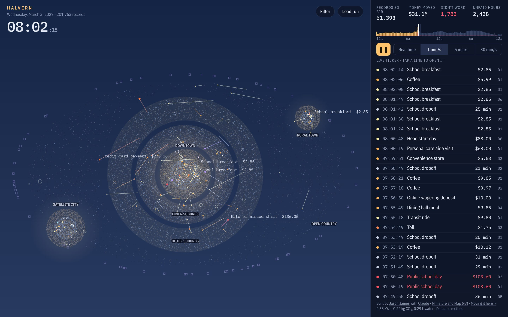
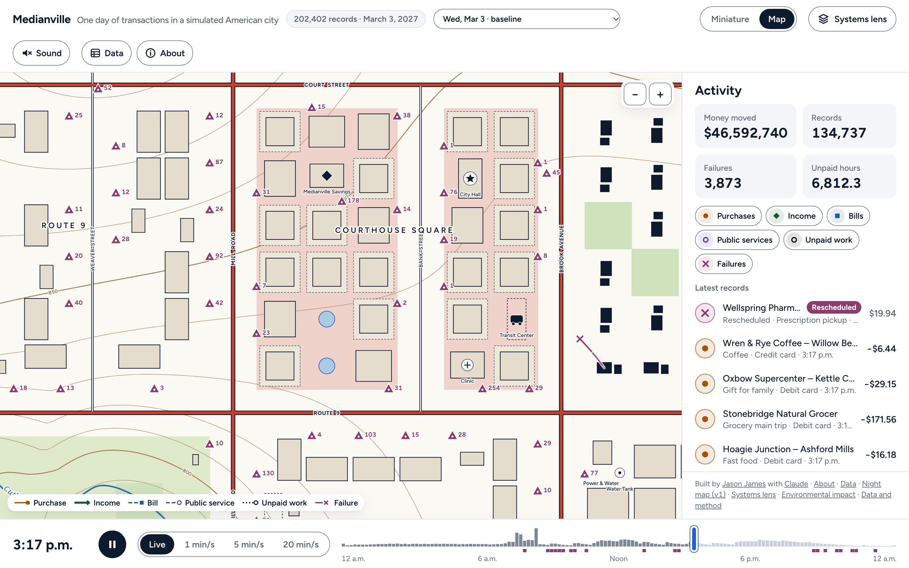
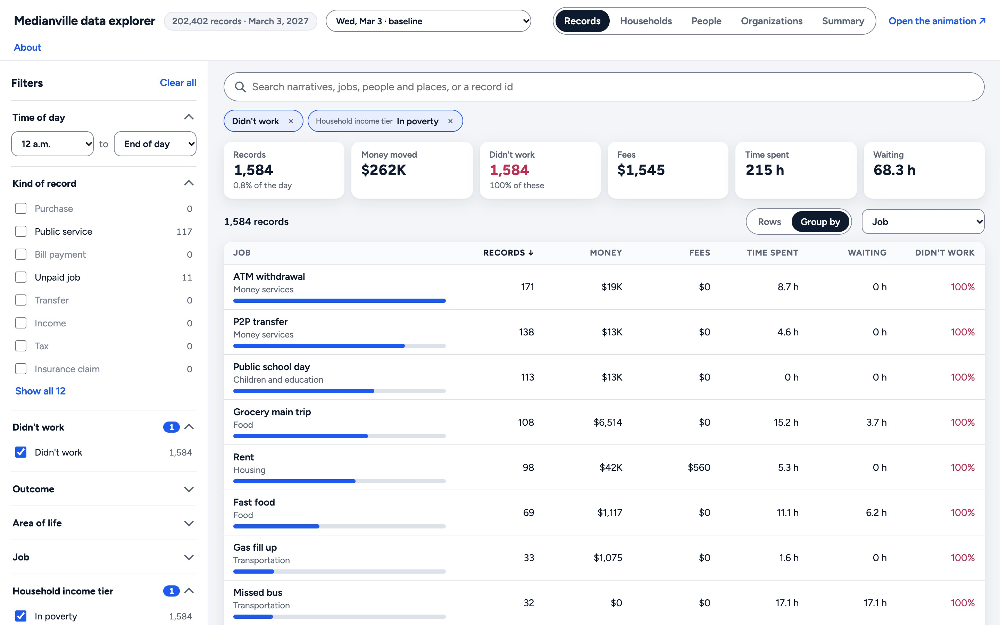

# Transactions are Jobs to be Done: Synthetic Market Animation

Two animated views of Halvern, an invented American city of about 100,000 people, that play back all 201,753 records from one simulated day (Wednesday, March 3, 2027): purchases, bills, paychecks, benefits, school days, bus rides, unpaid care and failed attempts. The night map draws each record as a light crossing an abstract map of the city's six districts. The latest viewer replays the same day on a 3D miniature town and on a printed map sheet, with sound. A systems lens opens over the city on one mapped block in each district, as stacked layers of the circumstances behind its records, with the feedback loops that keep them going. A data explorer lays out the same day as tables to filter, search and group, without the animation.

**Start here:** [mapping-synthetic-transactions/](https://jas0nmjames.github.io/playground/mapping-synthetic-transactions/) always opens the latest viewer. Earlier versions stay online, unchanged, in `v1/` and `v3/`.

## Versions

Viewers and data runs are numbered separately.

| Viewer | Where | Status |
|---|---|---|
| Latest: Miniature and Map, with the systems lens over the city, photographic light and surface, turning and tilting, and sound | [`/`](https://jas0nmjames.github.io/playground/mapping-synthetic-transactions/) | Current. New work lands here. |
| v3: Miniature and Map, as first shipped (Nov 17–18, 2026) | [`/v3/`](https://jas0nmjames.github.io/playground/mapping-synthetic-transactions/v3/) | Archived as shipped, from commit `0881c42`. |
| v1: the night map | [`/v1/`](https://jas0nmjames.github.io/playground/mapping-synthetic-transactions/v1/) | Archived as shipped, from commit `0881c42`. |

No viewer v2 shipped: the second round was a set of visual-direction prototypes in the Claude app, and the chosen direction became v3. The archived pages change only in their relative paths and an "Archived version" link back to the latest.

| Data run | File | Status |
|---|---|---|
| v1: Wednesday, March 3, 2027 | `data/halvern_2027-03-03.zip` | Current, and kept under this name for the archived viewers |
| v2: the evidence update | `data/runs/` (planned) | In progress; see `reference/halvern-data-update-plan.md` |

## Views

| | Night map (v1) | Miniature and Map (latest) |
|---|---|---|
| Live page | [mapping-synthetic-transactions/v1/](https://jas0nmjames.github.io/playground/mapping-synthetic-transactions/v1/) | [mapping-synthetic-transactions/](https://jas0nmjames.github.io/playground/mapping-synthetic-transactions/) |
| Look | Dark, full-screen night sky; districts as glowing rings and clusters | Light; a tabletop 3D town, or the same town as a printed topographic sheet (press **M** to switch) |
| City | The run's six districts, D1–D6, laid out as abstract shapes | v3's own small town; the run's districts and places are folded onto its homes and buildings |
| Record kinds | 13 colors, one per record type | 6 kinds with their own color, line and head: purchase, income, bill, public service, unpaid work, failure |
| Needs | Any modern browser | WebGL, plus three.js from a CDN (falls back to the map without it) |

Both animated pages load the same file, `data/halvern_2027-03-03.zip`, and link to each other and to the systems lens in their footers. The data explorer loads that file too.

### Night map



8:02 a.m., playing at one minute a second.

### Miniature and Map (latest)


The Miniature view at 12:19 p.m., playing at five minutes a second. Purple dashed arcs are public services, here children headed to school; pink pins count failures at a place.



The same moment in the Map view, zoomed out to show most of the sheet.

### Systems lens


The systems lens opens over the city in the latest viewer from a record's **What shaped this**, from a household's day, or from the **Systems lens** button in the header (**L**). It maps one composite block in each district, defined in `systems-lens/blocks.json`, and the run tags the records of those blocks' households, so the lens shows the record you opened. It also runs on its own at [systems-lens/](https://jas0nmjames.github.io/playground/mapping-synthetic-transactions/systems-lens/), where a menu switches blocks and each pin shows a composite example. The [design record](reference/halvern-systems-lens.md) explains the choices, and the three directions tried first are kept at [systems-lens/directions.html](https://jas0nmjames.github.io/playground/mapping-synthetic-transactions/systems-lens/directions.html).

The screenshots were taken from these pages in headless Chromium with software WebGL, at twice the pixel density.

### Data explorer



[explorer/](https://jas0nmjames.github.io/playground/mapping-synthetic-transactions/explorer/) is the run as tables: every record, household, person and organization, with filters, search and drill-downs. Here, the 1,732 records that didn't work for households in poverty, grouped by job.

## Watching the night map

Placeholder records move while the real day downloads (16 MB), and then the clock starts at 6:30 a.m.

- **Clock and timeline.** Play or pause with the button or the space bar. Pick a speed from real time up to 30 minutes per second, and drag the timeline to jump. The bars show how busy each five minutes is, with failures in red.
- **Map.** The six districts are drawn as rings and clusters: downtown in the middle, inner and outer suburbs around it, and the satellite city, rural town and open country outside. Dots are households, squares are outside parties such as the Treasury, and the color of each light is the kind of record.
- **Records.** Tap a light or a line in the ticker to open the record: the job statement ("When…, I want to…, so I can…"), who paid, who else paid, the cost to the public, time, travel, frictions and outcome. From there you can show the household's whole day, follow it on the map, or open the attempt a retry links back to.
- **Filter.** Narrow the map by kind of record, district, friction or failure, the 500 hand-written records (marked ✎), or a word in the job name.
- **Load run.** Loads another run from your computer: a zip from the simulator, or `records.csv` with `organizations.csv`, `households.csv` and `persons.csv`.

## Watching the latest viewer

The viewer's own placeholder day plays while the real one downloads. The chip in the header shows the progress, then "201,753 records · March 3, 2027". If the download fails, the chip says so and the placeholder keeps playing. The clock starts at 8:00 a.m.

- **Views.** **Miniature** is a 3D model of the town, lit by the sun and sky of the hour, with a focus blur (Off, Subtle or Full). **Map** is the same town drawn as a printed map sheet. **M** switches between them. Drag to pan, and scroll or use **+** and **−** to zoom.
- **Turning the miniature.** The round buttons beside the zoom buttons turn the board 15° at a time, and the compass between them shows north and puts it back up. With a mouse, drag with the right button, or hold Shift, Alt or Ctrl while dragging: sideways turns, up and down tilts, from a low skyline view at 8° to a steep 72°. On a touch screen, two fingers turn, tilt and zoom. Keys: **Q** and **E** turn, **N** puts north up, **Page Up** and **Page Down** tilt. The Map always stays north up.
- **Records in flight.** Each record arcs from one party to the other. Click a path to open it; where several overlap, a chooser lists them. With the keyboard, **[** and **]** step through the records in flight and **Enter** opens one.
- **Places.** Click a home or building to see its recent records. Since the real day is folded onto v3's town, each home or building also says how many real households or places it stands for. A pin counts the failures at a place so far today; click it to list them.
- **Activity.** Money moved, records, failures and unpaid hours so far; six filters, one per kind; and the latest records. Below 1,280 px wide, the Activity panel becomes a drawer.
- **A record.** Amount and status, from and to, method, time, category, record id (with hand-written records marked), the money breakdown, the job statement and the narrative. Under **Look closer**, **This household's day** lists the household's records so far and later, and keeps their paths drawn on the city. **What shaped this** opens the systems lens on the record, when its household lives on a mapped block and the record follows one of the block's patterns.
- **Systems lens.** The details rail widens into the lens over the city, and playback pauses. **Back to the city** or **Esc** returns to the record. Links of the form `#lens=larkin/R3/R0029594` open a block, a pattern or a record directly, and `#view=map` opens on the map.
- **Timeline.** Bars show records per ten minutes. Plum marks flag ten-minute stretches where failures run well above the day's usual share: overnight, when autopays bounce, and in the evening. Speeds are Live (the real clock), 1, 5 and 20 minutes a second. Page Up and Page Down move an hour.
- **Sound.** Off until you turn it on with the **Sound** button in the header or the **S** key. There are two layers, each with its own switch and volume, and the mix is remembered in your browser. **Background** (25% to start) is a quiet city that follows the hour: traffic and buses from the day's car and transit trips, voices from in-person records, birds at dawn, crossing chirps and wind. It follows the time of day in real seconds, so it doesn't speed up with playback. Zooming in brings the street closer; zooming out or tilting low toward the skyline leaves mostly wind and distant traffic. **Records** (60% to start) plays a soft pluck for each record shown, pitched by kind: income high, purchases and bills in the middle, public services and unpaid work low. A low thud marks a record that didn't work. Above 12 records a second the plucks thin into a sampled cloud, so faster playback sounds busier but not louder. The sound is all generated in the browser (`sound.js`), and it pauses when the tab is hidden. It was tuned in the Halvern Sound Lab.
- With reduced motion requested, the viewer starts paused and draws paths without animating them.

## Reading the systems lens

The lens takes two ideas into the project: system dynamics (stocks, flows and feedback) and societal context, after Donald Martin Jr.: "the dynamic and complex collection of social, cultural, historical, political, economic and environmental circumstances that surround and shape people, places and problems." It shows one composite block at a time, one in each district (Pelham Street downtown, Larkin Avenue in the inner suburbs, Fox Hollow in the outer suburbs, Mill Street in Ashford Mills, Main Street in Dunmore and the Route 9 Crossroads in open country), as six aligned layers of the same blocks.

- **Layers.** From the top: Today (the day's records), Economic, Political, Built & natural, Social & cultural, and Historical. Each label says how fast that layer changes, from "by the minute" to "bedrock, lasts a century". The same square on every layer is the same place.
- **A story.** Select a record or a circumstance. A blue column marks its square on every layer, dashed lines drop to what it rests on, and the layers in its story spread apart while the rest fold away. Each circumstance in the story gets a callout with its year and full text, such as "1983 · Historical: Halvern Works closes: 1,900 union jobs gone."
- **Lifting a layer.** Point at a layer in the list on the left to lift it, or select it to see it alone. **Esc** brings the rest back.
- **Loops.** Four feedback loops are drawn one at a time through the layers they cross: R1 Fee spiral, R2 Rollover, R3 Time tax and B1 Circle buffer. R loops reinforce and B loops balance; the + and − on each link say which way it pushes. Dotted arrows show circumstances on other layers that push a loop.
- **Details.** The right column describes the selection in v3's transaction-sheet style, and lists what shaped it, what it shapes and the loops it belongs to.

Everything in the lens is a composite of documented US patterns on invented blocks, and every loop is a hypothesis for the next run to test. The records are the run's own: `block_id`, `block_pattern` and `context_ids` in `records.csv` say which block's household made a record, which pattern it follows and which circumstances that pattern is mapped to.

## Using the data explorer

The page downloads the run (16 MB) and unpacks it in the browser, which takes a few seconds; nothing is uploaded anywhere.

- **Tabs.** Records, Households, People and Organizations are tables; Summary is the day at a glance.
- **Filters.** The left column lists each field with a count beside every value, and the counts follow the other filters. Records filter by kind, whether it didn't work, outcome, area of life, job, household income tier, district, friction, fee, channel, payment method, travel mode, third-party payer, funding level, lens, hand-written text and time of day. Households, people and organizations have their own, such as tier, circumstances, a $400 emergency, coverage, benefits, sector or what an organization accepts. On a phone, the filters open from a button.
- **Search.** Every word must match. Records search narratives, job statements, job names, party names and ids.
- **Totals.** The tiles above each table add up whatever is filtered: money moved, what didn't work, fees, time spent and waiting for records; median income, $400 emergencies and fees for households.
- **Group by.** Records can be grouped by any filter field, the hour, or who paid and who was paid, with records, money, fees, time, waiting and the share that didn't work for each group. Select a column to sort by it and a group to see its records.
- **Details.** Select a row to open it. A record shows its job statement, narrative, parties, money, time, tags and linked retries. A household shows its members, its money from the start of the day to the end, and its day's records. People and organizations show theirs. **Show these in Records** opens them as a filtered table.
- **Links.** Each tab and each open record, household, person or organization has its own address, such as `#records` or `#household-H05202`, so a view can be bookmarked or sent.
- **Download.** The filtered records download as CSV with all 31 columns.
- **Summary.** Who had something not work, by income tier; fees by tier; records and failures by hour; frictions; unpaid work; and who else pays. Select a bar or row to open the records behind it.

"Didn't work" follows the run's own definition: a failed attempt, or a record that ended declined, abandoned, failed or rescheduled. Partial records count as worked. With it, the Summary matches the run's `summary.md`: 6,896 records, and 13.4% of households (28.5% in poverty, 16.1% ALICE, 9.5% above ALICE). Unpaid hours count time spent plus waiting (16,736 hours), as the summary does.

The explorer doesn't link into a moment of the animations, because they don't accept a record or time in their address yet.

## Running them locally

No build step. Serve the folder, then open `/` for the latest viewer, `/v1/` for the night map, `/v3/` for archived v3, `/systems-lens/` for the systems lens and `/explorer/` for the data explorer:

```bash
python3 -m http.server 5181 --directory mapping-synthetic-transactions
```

Opening an `index.html` as a file can't fetch the data, so each animated page then plays its placeholder day, and the explorer says it couldn't load the run. The Miniature also needs internet access for three.js and its fonts.

## What's in this folder

| Path | What it is |
|---|---|
| `index.html` | The latest viewer, Miniature and Map: the city plan, both views, the activity panel, playback and the systems lens overlay |
| `real-day.js` | Loads the run for the latest viewer and folds it onto its town (see below) |
| `sound.js` | The latest viewer's sound, generated in the browser with Web Audio |
| `v1/index.html` | Archived: the night map (canvas map, timeline, ticker, record sheets and filters) |
| `v3/index.html`, `v3/real-day.js` | Archived: Miniature and Map (v3) as first shipped |
| `systems-lens/index.html` | The systems lens: the layers, callouts, loops and details sheet, with its prototype content built in |
| `explorer/index.html` | The data explorer: loading, tables, filters, search, group-by, detail sheets and summary, in one page |
| `systems-lens/directions.html` | The three directions tried first (Section, Exploded view, The Works), in their original hand-drawn style |
| `fflate.js` | [fflate](https://github.com/101arrowz/fflate) (MIT), used by every page to unzip the run in the browser |
| `data/halvern_2027-03-03.zip` | The complete run, exactly as delivered: the data tables, the simulator, and the hand-written records. Every viewer and the explorer load this file. |
| `data/halvern/` | The same package unpacked so it can be read on GitHub, without the four large tables (`records.csv`, 77 MB; `persons.csv`; `households.csv`; `household_ledger.csv`), which are only in the zip |
| `data/halvern/out/summary.md` | Counts, calibration against the anchors, fees, public dollars and the costliest frictions |
| `data/halvern/detailed_sample_500.csv` | The 500 hand-written records |
| `data/halvern/simulate.py`, `halvern_sim/` | The simulator (Python 3.10+ and numpy). The package's own [README](data/halvern/README.md) explains how to re-run it for another date, a storm, or several days in a row. |
| `screenshots/` | The five screenshots above |
| `reference/` | The documents behind the project, listed below |

### Reference documents

- [Seeing the Margins: What a Representative American Day Reveals](reference/seeing-the-margins.md): the research white paper. Why no real city stands in for the US, and what fragility, payment habits and government look like in an ordinary day.
- [Synthetic Mid-America: City Design v0.1](reference/synthetic-mid-america-city-design-v0.1.md): the design of the city, covering districts, economy, transaction model, field visits, and the lenses used to read it.
- [Halvern transaction generator prompt](reference/halvern-transaction-generator-prompt.md): the prompt that generated the data.
- [How the Halvern day was built](reference/halvern-build-approach.md): the method, what close reading of the sample caught, and what was left unfixed.
- [Halvern run record](reference/halvern-2027-03-03-run-record.md): what the run produced and how close it came to each anchor.
- [Halvern Systems Lens: design record](reference/halvern-systems-lens.md): the directions tried for the systems lens, what was decided, and what waits for the next run.
- [Halvern Miniature: realism design record](reference/halvern-miniature-realism.md): the tilt-shift references, the iterations tried in the realism lab, what was kept and how it works.

Everything in the data is synthetic. People, businesses and local agencies are invented. Federal programs keep their real names because the specification requires them. Synthetic data suggests where to look; it isn't evidence.

**Wages are boosted on purpose.** Each worker is paid 1.23 times the national pay for their occupation, about 14% more than a real worker in the same job in 2027. Halvern's households are smaller than real ones, so fewer paychecks reach each home, and the boost makes up for it. Household incomes, balances and bills are closer to right this way, but one person's paycheck runs high, so compare households rather than occupations. The [data update plan](reference/halvern-data-update-plan.md) explains the numbers; the next version, which rebuilds households at their real size, drops the boost.

## How the night map works

The page reads the CSVs directly as bytes, without turning every row into an object, so 201,753 records load in a few seconds. Each household and organization gets a fixed spot inside its district from a hash of its id, so the same entity always lands in the same place. As the clock advances, the page releases the records due by that time. It animates a sample of them along curved paths (up to 26 a frame on wide screens, 9 on phones), and the four counters stay exact. Records whose two ends are the same place, such as a school day, show as a ring that pulses outward instead.

Changes since the Claude artifact it came from:

- It loads `data/halvern_2027-03-03.zip` by itself on open, instead of asking for the file. If the download fails, it says so and falls back to the placeholder day and the Load run button.
- The placeholder day finishes building before the real one starts, so the two builds never share lookup tables.
- On narrow screens, floating captions stay inside the map.
- "Didn't work" now counts what the run's summary counts as a failure: every failed attempt, plus anything declined, abandoned, failed or rescheduled. It used to count "partial" outcomes too, which made it 8,726 by midnight instead of 6,896. "Money moved" leaves out failed records.
- Short names with characters such as the en dash in "Marlow's Market – Downtown" no longer come out garbled.
- Job names drop their group prefix ("Coffee", not "Food.coffee"), as in v3.
- A footer credits the page, links to the latest viewer and v3, and gives the impact figure below.

## How the Miniature and Map use the real day (since v3)

v3 was built as a Claude artifact around its own placeholder day: 4,130 records among 225 homes and 100 named buildings. `real-day.js` (once `v3/real-day.js`) swaps in the real run once it has downloaded. Records keep their real ids, names, amounts, districts, job statements and narratives. Only where they are drawn is approximate, because v3 draws one small town rather than the run's six districts.

**Homes.** Each household is drawn at one of v3's homes in the area its district folds into, picked by a hash of its id:

| Run's districts | Drawn at | Households |
|---|---|---|
| D1 Downtown, D2 Inner suburbs | Millbank's rowhouses (180 homes) | 22,222 |
| D3 Outer suburbs, D4 Satellite city, D5 Rural town | Brookfield Commons' houses (44 homes) | 18,781 |
| D6 Open country | The farm in Cutler Fields (1 home) | 2,447 |

People are drawn at their household's home. Record sheets still name the real district, such as "Household H14044 · Inner suburbs".

**Places.** Each of the 1,672 organizations is drawn at a v3 building of the closest kind, judged by its sector and name: diners (224), sheds for industry, construction, wholesale and transport (222), big-box stores, pharmacies and auto shops (178), office towers for finance, professional services and information (174), offices (166), the clinic (163), the church (121), corner shops, salons and barbers (108), the school, which also stands for child care and preschools (77), gas stations (40), city hall (39), the bank (32), grocery stores (31), the farm stand (11), the utility (6) and the transit center (2). The 78 parties outside Halvern, such as federal agencies, card networks and online services, sit at the east end of Route 9, "out of town".

**Kinds.** v3 had five record kinds. Public services were 39,000 of the day's records, so they get a sixth kind of their own rather than being drawn as purchases:

| Kind | Record types | Records |
|---|---|---|
| Purchase | purchase, benefit redemption, transfer, business to business | 90,797 |
| Income | income, benefit issuance | 10,258 |
| Bill | bill payment, tax, insurance claim | 41,785 |
| Public service (new: violet, long dashes, ring) | public service encounter | 38,975 |
| Unpaid work | non-monetary job | 13,042 |
| Failure | every failed attempt, plus anything declined, abandoned, failed or rescheduled | 6,896 |

**Volume.** The placeholder day had about 3 records a minute; the real one averages 140, with bursts in the hundreds. v3 now draws at most 28 new paths a second (14 on small screens) and caps the miniature's walking and driving figures. The counters, the activity feed, the failure pins and the timeline still count every record. A household whose day is open always has all of its paths drawn.

**Failures.** A failure gets a pin only at a place: the building of the organization involved, the nearest bus stop for a missed bus, or Route 9 for a party out of town. Failures with no outside party, such as a missed caregiving visit, are counted but not pinned.

**Memory.** Each record is a small object; a sheet reads the rest of the record's row from the CSV bytes only when it opens. The whole day used about 180 MB of JavaScript memory in Chromium.

By midnight v3 shows $56.1 million moved, 6,896 failures and 15,650 unpaid hours. The summary's 16,736 hours count all 13,201 non-monetary jobs, while v3 counts the 13,042 that didn't fail.

### How the miniature looks

The miniature's look came out of a realism lab built against tilt-shift photographs (see [the design record](reference/halvern-miniature-realism.md)). It keeps the town, the record language and the focus blur, and adds:

- **Sun and sky.** A solar path for March 3 near 39° N, with north up as on the Map: sunrise 6:48 a.m., sunset 6:12 p.m., the sun 44° high at noon. Sky colours follow the sun's height and light the town through an environment map, so shade takes the sky's colour and glass and paint reflect it. Exposure adjusts to the light.
- **Filmic tone.** Highlights roll off instead of clipping, with the saturation, contrast, split toning and grain of a print.
- **Contact shadows.** Darkening where things meet the ground and each other, so nothing floats.
- **Night lights.** Windows glow in the same occupancy pattern as before, lamps throw pools of light, cars have headlights and tail lights, signals cycle, and bright light blooms.
- **Street detail.** Lane lines, a double yellow line on the main roads, crosswalks and stop bars, signals and stop signs, cars parked along the curbs, hydrants, manholes, street trees downtown, lamps on the local streets, and units and water tanks on flat roofs.
- **Materials.** Paint, glass and water reflect the sky; walls, roofs, pavement and grass carry grain; no two parts are exactly the same colour.
- **Past the board.** The town sits in a wider region instead of on a table: suburbs, farms to the south-west and industry to the south-east, fading into haze.
- **Windows on every side,** so the board can turn.

The town itself is unchanged. Every addition draws from its own random stream, so each building, footprint, home, anchor and front-facing window is the same as before, in the same order; the plain centre dashes on the main roads gave way to the double yellow line. The Map and the run see the same city.

### Known limits

- The miniature needs WebGL and loads three.js 0.160.0 from jsDelivr. If either is missing, v3 switches to the map after 12 seconds.
- Positions are approximate, as described above, and a building's sheet lists the real places it stands for. v3's map labels and building names are its own inventions.
- In this container's software rendering, the miniature ran at about one frame a second, as the unmodified artifact did. Frame rates on real hardware weren't measured. The new look draws the scene twice plus its shadows, about six million triangles a frame with the land past the board, and renders at no more than 1.5 times the screen's pixel density to pay for it.

## Claude

The data was generated by Claude Fable 5.2 (`claude-fable-5-2`) in the Claude app, in one long session on November 16, 2026. That session is described in [How the Halvern day was built](reference/halvern-build-approach.md). The research, the city design, the night map and v3 were also made with Claude in the Claude app. None of those sessions can be counted from here.

The work in this repository was one Claude Code session (claude-opus-5-5) on November 17, 2026, in three passes:

1. **Moving the night map here.** Matched the project to its artifact, copied the page and unzip library, unpacked the run, added the reference documents, made the page load the run on its own, added the footer, tested it in headless Chromium at desktop and phone sizes, fixed the caption overflow that showed, wrote this README, and opened the pull request into `development`.
2. **Finding v3.** Found "Halvern in Motion: Miniature and Map" among the artifacts and checked what it needed to show the real day.
3. **v3 on the real day.** Read v3 in full, wrote `v3/real-day.js`, and changed v3 for real volumes: the public-service kind, the path budget, place-only pins, failure marks, real labels and sheets, and the header status. Fixed the garbled names and the failure count in both versions. Tested v3 in headless Chromium with three.js served locally: the day loaded in about 15 seconds with no errors, the counters matched the run's summary, and the record, household, building and pin sheets showed the right data. Took the screenshots, updated this README and the root README, and opened the pull request into `development`.

The systems lens was one Claude app session (claude-opus-5-5) on November 18, 2026, with the repository attached at the end. It explored three directions in the Biesty style, settled on the exploded view, added loops and callouts, restyled it to match v3, and then added the pages, the design record and the screenshot here, and opened the pull request into `development`. Its row is an estimate of about 90 model requests, counted from the session's tool calls rather than measured.

The data explorer was one Claude app session (claude-opus-5-5) on November 19, 2026. It read the run and v3's loader, wrote `explorer/index.html`, checked its counts against the run's summary, tested it in headless Chrome at desktop and phone sizes, took the screenshot, and wrote these README sections. That session couldn't push, so the change came to this repository as a patch. Its row is an estimate of about 70 model requests, counted from the session's tool calls rather than measured.

| Created | Tool | Model | Estimated energy consumption[^claude] | Estimated carbon emissions | Estimated water usage |
|---|---|---|---|---|---|
| November 16, 2026 | Claude app | claude-fable-5-2 | not measurable from here | — | — |
| November 2026 | Claude app (research, city design, night map, v3) | (unknown) | not measurable from here | — | — |
| November 17, 2026 | Claude Code | claude-opus-5-5 | 0.702 kWh | 0.271 kg CO₂ | 0.351 L |
| November 17, 2026 | Claude Code | claude-opus-5-5 | 0.108 kWh | 0.042 kg CO₂ | 0.054 L |
| November 17, 2026 | Claude Code | claude-opus-5-5 | 1.008 kWh | 0.389 kg CO₂ | 0.504 L |
| November 18, 2026 | Claude app (systems lens) | claude-opus-5-5 | 1.620 kWh | 0.625 kg CO₂ | 0.810 L |
| November 19, 2026 | Claude app (data explorer) | claude-opus-5-5 | 1.260 kWh | 0.486 kg CO₂ | 0.630 L |
| **Total (countable)** | | | **4.698 kWh** | **1.813 kg CO₂** | **2.349 L** |

[^claude]: assuming 18 Wh per model API request; carbon at 0.386 kg CO₂ per kWh and water at 0.5 L per kWh, as across this playground; does not include estimate for foundation model training. The Claude Code rows are the three passes above: 39 and 6 requests measured in the session transcript, and 56 for the third, of which 41 were measured before this README was written and 15 are an estimate for the README, the commit, the pull request and the reply. The first pass was estimated at 32 requests when it shipped and measured at 39 afterwards. That's 101 requests in all; at the time of measuring, the session had used ≈ 24M tokens, about 97% of them cache reads.
