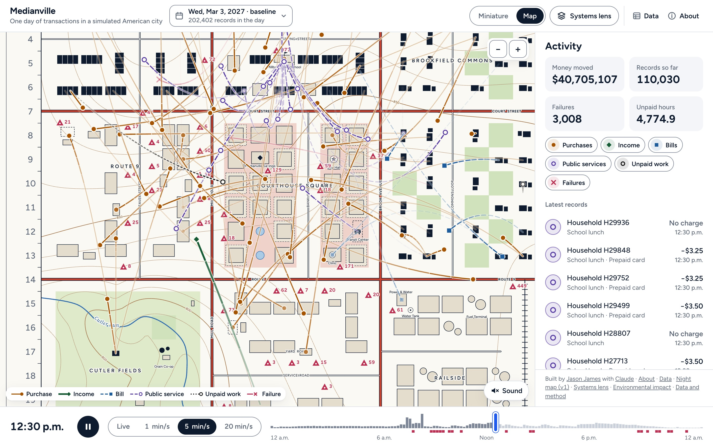
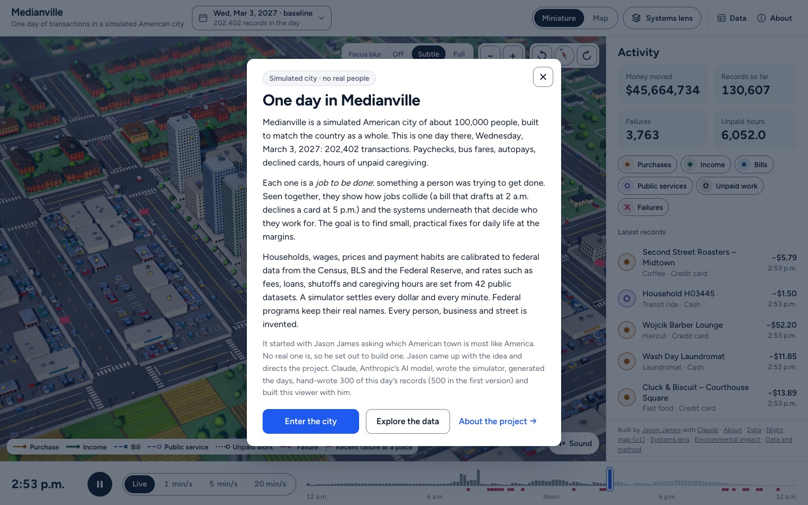
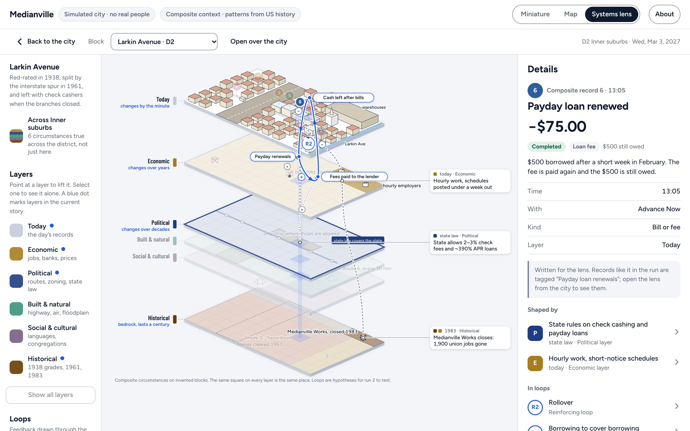
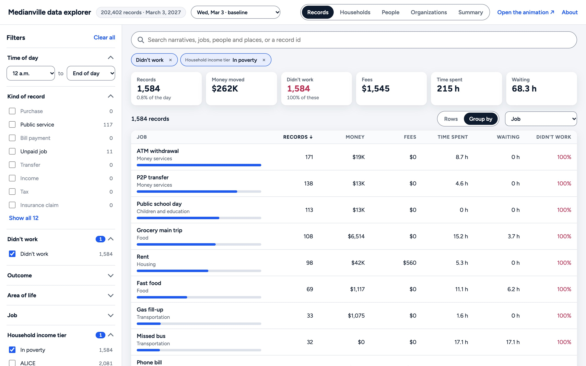

# Transactions are Jobs to be Done: Synthetic Market Animation

[](https://app.netlify.com/projects/medianville/deploys)

An animated view of Medianville, an invented American city of about 100,000 people, that plays back every record of one simulated day: Wednesday, March 3, 2027 by default (202,402 records in v2), or any of 18 other days that together stand for 2027. The records are purchases, bills, paychecks, benefits, school days, bus rides, unpaid care and failed attempts. The viewer replays the day on a 3D miniature town and on a printed map sheet, with sound. A systems lens opens over the city on one mapped block in each district, as stacked layers of the circumstances behind its records, with the feedback loops that keep them going. A data explorer lays out the same day as tables to filter, search and group, without the animation. A menu in the header of both switches days.

**Start here:** [mapping-synthetic-transactions/](https://jas0nmjames.github.io/playground/mapping-synthetic-transactions/) always opens the latest viewer. Earlier versions are kept, unchanged, in the [archive](archive/), and how the project was made, milestone by milestone, is in [the story](story/).

**About the name.** Medianville nods to Robert and Helen Lynd's *Middletown* (1929), their study of Muncie, Indiana, as a typical American town. "Median" is how this city is typical: it's weighted to the whole country, with households built by rule to match national shares from the Census Bureau's American Community Survey. (Drawing them from ACS microdata is planned for v3.) The Lynds picked Muncie partly because it was mostly white and native-born. Medianville's typicality comes from weighting, not from leaving groups out.

The city was called Halvern before 2026-11-20, and the archives keep that name.

## For agents

The live site has a small layer for agents and LLMs to read, as static files. [`llms.txt`](llms.txt) ([on the site](https://medianville.netlify.app/llms.txt)) is the way in: what Medianville is, the provenance note to say once at the start of a session (synthetic, grounded in real research, Jason James's project), how to cite it, and links to the rest. [`agents/`](agents/) holds Markdown pages: the About page, a data dictionary for every table, every run with its own README and summary, the districts and their circumstances, and the March month. [`llms-full.txt`](llms-full.txt) is all of it in one file. Every page starts with a one-line header that points back to `llms.txt`.

Agents bring their own compute: the day zips are linked on GitHub (`raw.githubusercontent.com`), not on this site, and [`robots.txt`](robots.txt) keeps crawlers off the zips. [`_headers`](_headers) serves the agent files as Markdown. Every page links `llms.txt` as `rel="alternate"`, and the About page carries a schema.org Dataset in JSON-LD. In the viewer and the explorer, a record's **Copy for AI** copies it as JSON with that context, to paste into a chat.

`tools/build_agent_pages.py` (standard library only) writes `agents/`, `llms-full.txt` and the JSON-LD from the About page, the run zips, the manifest, `systems-lens/blocks.json` and the month run record. Run it after changing any of them and commit what it writes; `sim/tests/test_agent_pages.py` fails when a page is stale. `llms.txt` is written by hand.

## History

The work is told as milestones, each with its own chapter in [the story](story/). Folders, tags and milestone titles use these names; viewers and data runs keep their own version numbers.

| Milestone | Viewer | Data run | Data plan phases |
|---|---|---|---|
| [M1 One day](story/01-one-day/) | v1, the first viewer ([archived](archive/)) | v1: `halvern_2027-03-03.zip` | — |
| [M2 Miniature and Map](story/02-miniature-and-map/) | v3 as first shipped ([archived](archive/)) | v1 | — |
| [M3 Grounding in evidence](story/03-grounding-in-evidence/) | — | v1, measured against evidence targets | 0, 1, 2 |
| [M4 The refined city](story/04-the-refined-city/) | latest (root) | v1 renamed: `medianville_2027-03-03.zip` | 3b (rename) |
| [M5 More time](story/05-more-time/) | latest, with the day menu | v2: 19 days and the March month | 3, 4, 5, "6"* |
| [M6 Refinements](story/06-refinements/) | latest | v2 | — |

\* [#82](https://github.com/jas0nmjames/playground/pull/82), the systems lens's district tier, shipped as "phase 6" of v2; the data update plan's own phase 6 is still to come.

[M0 The idea](story/00-the-idea/) came before any of it, and [Next: mining for projects](story/next-mining-for-projects/) is the goal still ahead. No viewer v2 shipped: the second round was a set of visual-direction prototypes in the Claude app, and the chosen direction became v3. The [archive](archive/) keeps the frozen viewers; they change only in their relative paths and an "Archived version" link back to the latest.

### Data runs

| Data run | File | Status |
|---|---|---|
| v1: Wednesday, March 3, 2027 | `data/halvern_2027-03-03.zip` | Frozen as shipped. The archived viewers load it. |
| v1, renamed | `data/medianville_2027-03-03.zip` | The same run with only the city's name changed, written by `tools/rename_run.py`. The latest viewer and the explorer list it in their day menu as v1. |
| v2: the evidence update | `data/runs/v2/medianville_<date>.zip`, 19 days listed in `data/runs/manifest.json`; simulator in `sim/` (the `medianville_sim` package), frozen at commit `dd0e6b6` | Current, 2026-11-21. The baseline day (Wednesday, March 3, 2027, with 300 hand-written records) and the 18 typed days that stand for 2027. The latest viewer and the explorer open the baseline day; `?run=<id>` or the day menu opens another. See the [data update plan](story/03-grounding-in-evidence/medianville-data-update-plan.md) and the [close reading](story/05-more-time/medianville-v2-close-reading.md). |
| v2, phase 4: March 1–31, 2027, carried day to day | GitHub Release `medianville-v2-month-2027-03`: [download (about 460 MB), not needed to use the site](https://github.com/jas0nmjames/playground/releases/download/medianville-v2-month-2027-03/medianville_2027-03_month.zip) | Built 2026-11-20 and rebuilt 2026-11-21 on the frozen simulator: 5.7 million records with the chains across days (unpaid bills, shutoffs, overdrafts, payday and title loans). The pages never load it. Checks and summary in `sim/evidence/results/v2_month_2027-03/`; see the [month run record](story/05-more-time/medianville-2027-03-month-run-record.md). |

## Views

The viewer and the data explorer read `data/runs/manifest.json` (through `runs.js`) and open its default run, v2's baseline day; the day menu reloads the page with `?run=<id>`, and the link to the other page keeps the choice. Without the manifest they fall back to `data/medianville_2027-03-03.zip`.

### Miniature and Map


The Miniature view at 12:30 p.m., playing at five minutes a second. Amber arcs are purchases and violet dashed arcs public services, here children headed to school; each small crimson flag marks a place where something failed in the last few minutes.



The same moment in the Map view, zoomed out to show most of the sheet.



On a first visit, an intro opens over the city while the day loads, and **About** in the header reopens it. The full [About page](https://jas0nmjames.github.io/playground/mapping-synthetic-transactions/about/) covers the origin, method, sources, limits and credits ([phone](story/06-refinements/intro-phone.jpg); About page on [desktop](story/04-the-refined-city/about-desktop.jpg) and [phone](story/04-the-refined-city/about-phone.jpg)).

### Systems lens



The systems lens opens over the city in the latest viewer from a record's **What shaped this**, from a household's day, or from the **Systems lens** button in the header (**L**). It maps one composite block in each district, defined in `systems-lens/blocks.json`, and the run tags the records of those blocks' households, so the lens shows the record you opened. Every other record opens its district's block on the **district tier**: the circumstances true across the whole district, with the bar above the lens saying the record comes from elsewhere in the district. It also runs on its own at [systems-lens/](https://jas0nmjames.github.io/playground/mapping-synthetic-transactions/systems-lens/), where a menu switches blocks and each pin shows a composite example. The [design record](story/04-the-refined-city/medianville-systems-lens.md) explains the choices, and the three directions tried first are kept at [systems-lens/directions.html](https://jas0nmjames.github.io/playground/mapping-synthetic-transactions/systems-lens/directions.html).

The screenshots were taken from these pages in headless Chrome, driven over the DevTools protocol so each one shows a set moment (the viewer at 12:30 p.m., playing at five minutes a second), at twice the pixel density; the intro is at 1× and the phone intro at 390 × 844.

### Data explorer



[explorer/](https://jas0nmjames.github.io/playground/mapping-synthetic-transactions/explorer/) is the run as tables: every record, household, person and organization, with filters, search and drill-downs. Here, the 1,584 records that didn't work for households in poverty on the baseline day, grouped by job.

## Watching the latest viewer

The page is titled **Medianville**, with the subtitle "One day of transactions in a simulated American city". A small built-in sample day plays while the full simulation downloads. The day control beside the title shows the progress ("Sample day" over "Loading the full simulation 42%"), then the day over its size ("Wed, Mar 3, 2027 · baseline" over "202,402 records in the day"); clicking anywhere on it opens the list of days. If the download fails, it says so and the sample day keeps playing. Playback starts in **Live**: the simulated day runs at your own time of day, one minute a minute. Pick 1, 5 or 20 min/s to speed it up.

- **Header and layout.** At 1,280 px and wider, the header holds the title, the day control, the view switch and **Systems lens**, then **Data** and **About** as plain links after a thin rule. Narrower, the header slims to the title, **Activity** and a menu (☰) with the day control and focus blur, then **Data** and **About** as rows with chevrons; the view switch and **Systems lens** sit over the city's top-left corner. On touch screens every control is at least 44 px. On a phone the speed buttons read Live, 1, 5 and 20 min/s. **Sound** sits on the city's bottom-right corner at every width (just its icon below 760 px), with its panel opening upward. The key to the record kinds runs along the bottom-left of the city; below 760 px wide or 620 px tall, a **Key** button there opens it as a small card instead, and your browser remembers whether it's open (`medianville-key-v1`).
- **Views.** **Miniature** is a 3D model of the town, lit by the sun and sky of the hour, with a focus blur (Off, Subtle or Full). **Map** is the same town drawn as a printed map sheet, set in the viewer's own type (Figtree) and navy ink on light paper, with its legend, scale and title block in the margin below the frame. **M** switches between them. Drag to pan, and scroll or use **+** and **−** to zoom.
- **Turning the miniature.** The round buttons beside the zoom buttons turn the board 15° at a time, and the compass between them shows north and puts it back up. With a mouse, drag with the right button, or hold Shift, Alt or Ctrl while dragging: sideways turns, up and down tilts, from a low skyline view at 8° to a steep 72°. On a touch screen, two fingers turn, tilt and zoom. Keys: **Q** and **E** turn, **N** puts north up, **Page Up** and **Page Down** tilt. The Map always stays north up.
- **Records in flight.** Each record arcs from one party to the other. When it lands, its path fades but its end mark stays where it ended, smaller, fading over three simulated minutes, so at Live the city shows where its last few minutes of activity went (at faster speeds the marks fade in a blink). Click a path in flight or an end mark to open the record; hovering an end mark draws its path again. Where several overlap, a chooser lists them. With the keyboard, **[** and **]** step through the records in flight and **Enter** opens one.
- **Places.** Click a home or building to see its recent records. Since the real day is folded onto v3's town, each home or building also says how many real households or places it stands for. When something fails at a place, a small crimson flag goes up there in the Miniature (a crimson triangle on the Map). Hover it for the place's failures so far today, or click it to list them; zoomed in, the flag carries the count itself. The flag comes down once the place has gone eight simulated minutes without another failure, and stays up at least four seconds at fast speeds.
- **Activity.** Money moved, records, failures and unpaid hours so far; six filters, one per kind; and the latest records. Below 1,280 px wide, the Activity panel becomes a drawer. The list of latest records holds still while you use it (the mouse over it, scrolled down, keyboard focus in it, or the drawer open on a touch screen), so a row can't move out from under a click; new records wait behind an "N new" button beside the heading.
- **A record.** Amount and status, from and to, method, time, category, record id (with hand-written records marked), the money breakdown, the job statement and the narrative. Under **Look closer**, **This household's day** lists the household's records so far and later, and keeps their paths drawn on the city. **What shaped this** opens the systems lens on the record when its household lives on a mapped block and the record follows one of the block's patterns; **What shapes this household's block** opens the block when the household lives there but the record isn't one of its patterns; and for every other record, **What shapes places like this** opens the district's mapped block on its district tier. A household's day has the same link. Only a record with no district would have none. Last, **Copy for AI** copies the record for an assistant: a line saying it is synthetic and where its context is (`llms.txt`), the record id and day, every field as JSON, and three starter questions. A small note at the bottom of the screen confirms it. Nothing is sent anywhere; it only goes to the clipboard.
- **Systems lens.** The details rail widens into the lens over the city, and playback pauses. **Back to the city** or **Esc** returns to the record. Links of the form `#lens=larkin/R3/R0029594` open a block, a pattern or a record directly, `#lens=larkin/district` opens a block's district tier, and `#view=map` opens on the map. On a phone the lens fills the screen.
- **Timeline.** Bars show records per ten minutes. Crimson marks flag ten-minute stretches where failures run well above the day's usual share: overnight, when autopays bounce, and in the evening. Speeds are Live (the real clock), 1, 5 and 20 minutes a second. Page Up and Page Down move an hour.
- **Sound.** Off until you turn it on with the **Sound** button at the city's bottom-right corner or the **S** key. There are two layers, each with its own switch and volume, and the mix is remembered in your browser (`medianville-sound-v1`; a mix saved before the rename carries over). **Background** (25% to start) is a quiet city that follows the hour: traffic and buses from the day's car and transit trips, voices from in-person records, birds at dawn, crossing chirps and wind. It follows the time of day in real seconds, so it doesn't speed up with playback. Zooming in brings the street closer; zooming out or tilting low toward the skyline leaves mostly wind and distant traffic. **Records** (60% to start) plays a soft pluck for each record shown, pitched by kind: income high, purchases and bills in the middle, public services and unpaid work low. A low thud marks a record that didn't work. Above 12 records a second the plucks thin into a sampled cloud, so faster playback sounds busier but not louder. The sound is all generated in the browser (`sound.js`), and it pauses when the tab is hidden. If the browser never starts its audio (an embedded browser with no audio output, for example), the panel says so a second after sound is turned on, rather than looking as if it worked. It was tuned in the project's sound lab.
- With reduced motion requested, the viewer starts paused and draws paths without animating them.
- **Intro and About.** A first visit opens an intro over the city: what Medianville is, how it was made and who made it. Its main button reads "Loading the day…" until the run is in, then "Enter the city"; Esc, the close button or a click on the dimmed city also close it. It's remembered in your browser (`medianville-intro-v1`), and **About** in the header opens it again. Any `#lens=…` or `#view=…` link, and `?intro=0`, skip it; `?intro=1` shows it anyway. While it's open the viewer's keys do nothing.
- **Data.** **Data** in the header opens the explorer. A record's **Look closer** list and a household's day each end with **Open in data explorer**, which opens the explorer on that record (`explorer/#record-R0000001`) or household (`explorer/#household-H00001`).

## Reading the systems lens

The lens takes two ideas into the project: system dynamics (stocks, flows and feedback) and societal context, after Donald Martin Jr.: "the dynamic and complex collection of social, cultural, historical, political, economic and environmental circumstances that surround and shape people, places and problems." It shows one composite block at a time, one in each district (Pelham Street downtown, Larkin Avenue in the inner suburbs, Fox Hollow in the outer suburbs, Mill Street in Ashford Mills, Main Street in Dunmore and the Route 9 Crossroads in open country), as six aligned layers of the same blocks.

- **Layers.** From the top: Today (the day's records), Economic, Political, Built & natural, Social & cultural, and Historical. Each label says how fast that layer changes, from "by the minute" to "bedrock, lasts a century". The same square on every layer is the same place.
- **A story.** Select a record or a circumstance. A blue column marks its square on every layer, dashed lines drop to what it rests on, and the layers in its story spread apart while the rest fold away. Each circumstance in the story gets a callout with its year and full text, such as "1983 · Historical: Medianville Works closes: 1,900 union jobs gone."
- **Lifting a layer.** Point at a layer in the list on the left to lift it, or select it to see it alone. **Esc** brings the rest back.
- **Loops.** Feedback loops are drawn one at a time through the layers they cross; Larkin's are R1 Fee spiral, R2 Rollover, R3 Time tax and B1 Circle buffer, plus its district loop, D1 Borrowing to cover borrowing. R loops reinforce and B loops balance; the + and − on each link say which way it pushes. Dotted arrows show circumstances on other layers that push a loop.
- **District tier.** Each block also carries five or six circumstances true across its whole district, not just its street (for the inner suburbs: high-cost lenders, utility arrears, check cashers chosen on purpose, thinned bus routes, the 1930s lending maps and aging postwar houses), and a district loop, D1. A record from elsewhere in the district opens the lens in district mode: those circumstances are the story, each with an **Across** pill, the district loop is drawn, and the block's own circumstances and patterns stay folded under **On Larkin Avenue itself**. **Across Inner suburbs** in the left column turns district mode on and off from the block's own view. Every district has a historical, political, economic and built & natural circumstance; the social layer is still empty downtown, in the satellite city and in the rural town. The block's own history rests on the district's (Larkin's 1938 grades on the 1930s lending maps).
- **Details.** The right column describes the selection in v3's transaction-sheet style, and lists what shaped it, what it shapes and the loops it belongs to.

Everything in the lens is a composite of documented US patterns on invented blocks, and every loop is a hypothesis for the next run to test. The district tier's figures are national or from documented cases and say so; nothing local is named. The records are the run's own: `block_id`, `block_pattern` and `context_ids` in `records.csv` say which block's household made a record, which pattern it follows and which circumstances that pattern is mapped to.

## Using the data explorer

The page downloads the day (12 to 19 MB) and unpacks it in the browser, which takes a few seconds; nothing is uploaded anywhere. The day menu in the header opens another day.

- **Tabs.** Records, Households, People and Organizations are tables; Summary is the day at a glance.
- **Filters.** The left column lists each field with a count beside every value, and the counts follow the other filters. Records filter by kind, whether it didn't work, outcome, area of life, job, household income tier, district, friction, fee, channel, payment method, travel mode, third-party payer, funding level, lens tags, hand-written text and time of day. Households, people and organizations have their own, such as tier, circumstances, a $400 emergency, coverage, benefits, sector or what an organization accepts. On a phone, the filters open from a button.
- **Search.** Every word must match. Records search narratives, job statements, job names, party names and ids.
- **Totals.** The tiles above each table add up whatever is filtered: money moved, what didn't work, fees, time spent and waiting for records; median income, $400 emergencies and fees for households.
- **Group by.** Records can be grouped by any filter field, the hour, or who paid and who was paid, with records, money, fees, time, waiting and the share that didn't work for each group. Select a column to sort by it and a group to see its records.
- **Details.** Select a row to open it. A record shows its job statement, narrative, parties, money, time, tags and linked retries, and **What shaped this**, which opens the systems lens over the city by the viewer's rules (its pattern, its household's block, or its district's block on the district tier), on the same day. A household shows its members, its money from the start of the day to the end, and its day's records. People and organizations show theirs. **Show these in Records** opens them as a filtered table. A record's **Copy for AI** copies the same text as the viewer's button, to paste into a chat.
- **Links.** Each tab and each open record, household, person or organization has its own address, such as `#records` or `#household-H05202`, so a view can be bookmarked or sent.
- **Download.** The filtered records download as CSV with all 34 columns.
- **Summary.** Who had something not work, by income tier; fees by tier; records and failures by hour; frictions; unpaid work; and who else pays. Select a bar or row to open the records behind it.

"Didn't work" follows the run's own definition: a failed attempt, or a record that ended declined, abandoned, failed or rescheduled. Partial records count as worked. With it, the Summary matches the run's `summary.md`. On v2's baseline day that is 6,168 records, and 12.3% of households (25.9% in poverty, 13.6% ALICE, 9.3% above ALICE); unpaid hours count time spent plus waiting (12,395 hours), as the summary does. (v1's March 3: 6,896 records, 13.4% of households, 16,736 unpaid hours.)

The explorer doesn't link into a moment of the animations, because they don't accept a record or time in their address yet.

## Running them locally

No build step. Serve the folder, then open `/` for the latest viewer, `/systems-lens/` for the systems lens, `/explorer/` for the data explorer and `/archive/` for the archived viewers:

```bash
python3 -m http.server 5181 --directory mapping-synthetic-transactions
```

Opening an `index.html` as a file can't fetch the data, so each animated page then plays its placeholder day, and the explorer says it couldn't load the run. The Miniature also needs internet access for three.js and its fonts.

## Running the simulator

The v2 simulator needs Python 3.10 or later and numpy. From `sim/`:

```bash
python3 simulate.py --out out
```

That is one day (Wednesday, March 3, 2027, the full city, seed 20270303). `--date`, `--weather storm|heat`, `--households N` and `--seed N` change it. With `--days N` the city is carried forward day by day: balances, unpaid bills waiting to be retried, shutoff notices running out, overdrafts, payday and title loans, SNAP balances and the weeks' hours all carry (`sim/medianville_sim/carry.py`), and each day also writes `links.csv`, which ties records into chains across days. `--state-out` and `--state-in` save and continue a carried run; `--carry` carries a single day.

The March 2027 month (phase 4), its checks and its bundle:

```bash
python3 simulate.py --date 2027-03-01 --days 31 --out month
```

```bash
python3 evidence/month.py month evidence/results/v2_month_2027-03
```

```bash
python3 ../tools/pack_month.py month evidence/results/v2_month_2027-03 ../data/medianville_2027-03_month.zip
```

The typed-day year: `python3 evidence/checks.py run OUT --label TEXT`. Tests: `python3 -m pytest tests --run-slow`.

The published days (phase 5): run the baseline day and each typed day into one folder (`simulate.py --out runs/2027-03-03`, then `--date D [--weather W] --out runs/D` for each day `evidence/typed_days.py` lists), then

```bash
python3 ../tools/pack_runs.py runs --commit dd0e6b6
```

which writes `data/runs/v2/medianville_<date>.zip` and `data/runs/manifest.json`, the same bytes every time. The baseline day picks up the hand-written text from `sim/detailed_overrides.csv` by itself. `tools/sample_records.py` draws a stratified sample of a run as readable cards (the close reading) or one line a record (for writing); `tools/merge_detailed.py` merges `sim/detail_parts/part*.txt` into the overrides.

## What's in this folder

| Path | What it is |
|---|---|
| `index.html` | The latest viewer, Miniature and Map: the city plan, both views, the activity panel, playback, the systems lens overlay and the first-visit intro |
| `about/index.html` | The About page: what the project is, where it came from, how it was made, sources, limits and credits. Plain HTML and CSS. |
| `real-day.js` | Loads the run for the latest viewer and folds it onto its town (see below) |
| `runs.js` | Reads `data/runs/manifest.json` for both viewers: which day to open (the default, or `?run=<id>`) and the day menu |
| `sound.js` | The latest viewer's sound, generated in the browser with Web Audio |
| `archive/` | The frozen viewers, one folder per milestone (M1's first viewer, and v3 as first shipped with its `real-day.js`), each with its own README, and an [index page](archive/) that shows them side by side |
| `v1/index.html`, `v3/index.html` | Redirects to the archive, so old links and bookmarks still work |
| `systems-lens/index.html` | The systems lens: the layers, callouts, loops and details sheet, with its prototype content built in |
| `explorer/index.html` | The data explorer: loading, tables, filters, search, group-by, detail sheets and summary, in one page |
| `systems-lens/directions.html` | The three directions tried first (Section, Exploded view, The Works), in their original hand-drawn style |
| `fflate.js` | [fflate](https://github.com/101arrowz/fflate) (MIT), used by every page to unzip the run in the browser |
| `data/halvern_2027-03-03.zip` | The v1 run, frozen exactly as delivered under the city's first name: the data tables, the simulator, and the hand-written records. The archived viewers load this file. |
| `data/medianville_2027-03-03.zip` | The same run with only the name changed, in every file's contents and paths (`medianville/`). The day menu lists it as v1. |
| `data/runs/manifest.json`, `data/runs/v2/medianville_<date>.zip` | v2's published days: the baseline day and the 18 typed days, each a zip of the day's tables, the systems lens's blocks, the simulator, a README and `SHA256SUMS` (the baseline day also carries the hand-written text). The manifest lists every run, v1 included, with its size and SHA-256. |
| `tools/rename_run.py` | Writes the renamed copy from the frozen zip. Mapping the copy back gives every file of the original byte for byte; `sim/tests/test_rename_run.py` checks it. |
| `data/halvern/` | The frozen v1 package unpacked so it can be read on GitHub, without the four large tables (`records.csv`, 77 MB; `persons.csv`; `households.csv`; `household_ledger.csv`), which are only in the zip |
| `data/halvern/out/summary.md` | Counts, calibration against the anchors, fees, public dollars and the costliest frictions |
| `data/halvern/detailed_sample_500.csv` | The 500 hand-written records |
| `data/halvern/simulate.py`, `halvern_sim/` | The v1 simulator, frozen (Python 3.10+ and numpy). The package's own [README](data/halvern/README.md) explains how to re-run it for another date, a storm, or several days in a row. `sim/tests` checks that it still reproduces the zip byte for byte. |
| `sim/detailed_overrides.csv`, `sim/detailed_sample.csv`, `sim/detail_parts/` | v2's 300 hand-written records: the text keyed to the baseline day's record ids, the finished rows on their own, and the parts they were written in |
| `tools/pack_runs.py`, `tools/sample_records.py`, `tools/merge_detailed.py` | Pack the published days and write the manifest; draw samples to read or write; merge the hand-written parts |
| `sim/simulate.py`, `sim/medianville_sim/` | The v2 simulator, frozen for v2's hand-written records, with its tests (`sim/tests/`), evidence targets (`sim/evidence_targets.csv`) and typed-day checks (`sim/evidence/`). See the [data update plan](story/03-grounding-in-evidence/medianville-data-update-plan.md). `medianville_sim/carry.py` is what a run of several days carries from one day to the next (phase 4). |
| `sim/evidence/month.py`, `sim/evidence/month_targets.csv` | The month's evidence checks: its targets, the chains across days, and the typed-day targets over the month |
| `sim/evidence/results/v2_month_2027-03/` | The March 2027 month's `summary.md` and `evidence_checks.md`. The month itself is a Release download (above), not in the repo. |
| `tools/pack_month.py` | Packs a carried month into one zip, the same bytes every time, with a `SHA256SUMS` file inside |
| `evidence/` | The real-accounts research that came before the downloads: the human-evidence report (the first day scored against 69 real sources), its 69 sources, 76 findings and 25 quotes, and the prompt that produced them. The findings' `E` ids are the `evidence_ids` in `systems-lens/blocks.json`. |
| `sources/` | The download manifest and log, the tools that build `sources/derived/` from the raw downloads, and the derived tables the simulator reads. Raw files stay out of git. |
| `story/` | How the project was made, one folder per milestone: the documents behind it, the decision log and the screenshots, listed below |
| `tools/check_links.py` | Checks every link in the project's documents and pages, relative or to this repo on GitHub, Pages and the Netlify site |
| `llms.txt`, `llms-full.txt`, `agents/` | The pages for agents and LLMs (see [For agents](#for-agents)); `llms.txt` by hand, the rest written by `tools/build_agent_pages.py` |
| `robots.txt`, `_headers` | Crawlers welcome everywhere but the zips; Netlify's headers for the agent files and the data |
| `LICENSE-DATA`, `CITATION.cff` | The CC BY 4.0 notice for the data and documents, and how to cite them (see [License](#license)) |

### The story and its documents

[`story/`](story/) tells the project as milestones and holds the documents behind it, each in the milestone that produced it:

- [The story](story/README.md): the arc on one page, with the version table and a line per milestone.
- [Design decision log](story/decisions.md): every decision behind the project, with why, what else was considered, what it costs, whose call it was and its milestone.
- **M0 The idea:** [Seeing the Margins: What a Representative American Day Reveals](story/00-the-idea/seeing-the-margins.md), the research white paper (why no real city stands in for the US, and what fragility, payment habits and government look like in an ordinary day), and [Synthetic Mid-America: City Design v0.1](story/00-the-idea/synthetic-mid-america-city-design-v0.1.md), the design of the city: districts, economy, transaction model, field visits, and the lenses used to read it.
- **M1 One day:** [the transaction generator prompt](story/01-one-day/medianville-transaction-generator-prompt.md) that generated the data; [how the day was built](story/01-one-day/medianville-build-approach.md): the method, what close reading of the sample caught, and what was left unfixed; and the [run record](story/01-one-day/medianville-2027-03-03-run-record.md): what the run produced and how close it came to each anchor.
- **M3 Grounding in evidence:** the [data update plan](story/03-grounding-in-evidence/medianville-data-update-plan.md): how the evidence was folded in and the run went past one day, phase by phase, with each phase's status; and the [human evidence report](evidence/report.md): the first day scored against 69 real sources, kept as written, with its [sources](evidence/sources.csv), [findings](evidence/evidence.csv), [quotes](evidence/quotes.csv) and [research prompt](evidence/research-prompt.md).
- **M4 The refined city:** the [systems lens design record](story/04-the-refined-city/medianville-systems-lens.md): the directions tried, what was decided, and what waits for the next run; and the [miniature realism design record](story/04-the-refined-city/medianville-miniature-realism.md): the tilt-shift references, the iterations tried in the realism lab, what was kept and how it works.
- **M5 More time:** the [v2 run record](story/05-more-time/medianville-v2-run-record.md): the 19 published days (phase 5): kinds, weights, records, sizes, SHA-256, how they were checked and how to rebuild them; the [month run record](story/05-more-time/medianville-2027-03-month-run-record.md): the March 2027 month (phase 4, rebuilt in phase 5): dates, seed, records, size, SHA-256, how to rebuild it, and where to download it; and the [v2 close reading](story/05-more-time/medianville-v2-close-reading.md): 200 records read by two readers before v2 was frozen, what they found, what was fixed and what was left for v3. The second readers' reports on [the sample](story/05-more-time/medianville-v2-second-reader.md) and on [the hand-written records](story/05-more-time/medianville-v2-handwritten-second-reader.md) are kept as written.

The documents were in `reference/` until 2026-11-24. The frozen simulator in `sim/`, its targets and the packing tools still name them by their old `reference/` paths, because changing them would change the published zips; [the story's README](story/README.md#where-the-documents-were) maps each old path to its new one.

Everything in the data is synthetic. People, businesses and local agencies are invented. Federal programs keep their real names because the specification requires them. Synthetic data suggests where to look; it isn't evidence.

### Data sources

The research came in four rounds, and the [About page](https://jas0nmjames.github.io/playground/mapping-synthetic-transactions/about/#sources) lists every source:

1. **Calibration anchors** for the first run: the American Community Survey, Current Employment Statistics, the Diary of Consumer Payment Choice, SHED, United For ALICE, the Consumer Expenditure Survey and 2027 program figures ([run record](story/01-one-day/medianville-2027-03-03-run-record.md)).
2. **Real accounts** beside the first day: 69 sources, 76 findings and 25 quotes in [`evidence/`](evidence/), summed up in the [evidence report](evidence/report.md), which named what v2 had to add.
3. **Downloaded datasets** that set v2's rates: 42 public datasets in [`sources/manifest.csv`](sources/manifest.csv) (10 more listed for later versions), built into `sources/derived/` and named target by target in `sim/evidence_targets.csv`.
4. **District history** behind the systems lens: each circumstance's `source_note` in `systems-lens/blocks.json`.

**Wages are boosted on purpose.** Each worker is paid 1.23 times the national pay for their occupation, about 14% more than a real worker in the same job in 2027. Medianville's households are smaller than real ones, so fewer paychecks reach each home, and the boost makes up for it. Household incomes, balances and bills are closer to right this way, but one person's paycheck runs high, so compare households rather than occupations. The [data update plan](story/03-grounding-in-evidence/medianville-data-update-plan.md) explains the numbers; the next version, which rebuilds households at their real size, drops the boost.

**What v2 still gets wrong.** v2 keeps v1's people so the two can be compared, and some of v1's households don't hold up. The [close reading](story/05-more-time/medianville-v2-close-reading.md) lists them, and the next version, drawn from Census microdata, redraws them:
- SSI goes to people whose household income or spouse rules it out, and some SSI recipients have no Medicaid.
- Coverage doesn't always follow eligibility, such as uninsured adults with no income.
- Every renter with no income pays the same $380.
- Refundable credits reach some households earning well over the EITC limit (about 140 of the day's 640).
- Some jobs are paired with unrelated employers.
- A few trips run 60 to 80 miles.
- Overdraft fees fall on fewer accounts than in life.
- `time_minutes` counts the wait but not the travel.

## How the Miniature and Map use the real day (since v3)

The figures in this section are for v1's March 3, the day v3 first loaded; v2's days differ a little (the explorer and each run's `summary.md` have their counts).

v3 was built as a Claude artifact around its own placeholder day: 4,130 records among 225 homes and 100 named buildings. `real-day.js` (once `v3/real-day.js`; the copy as first shipped is in [`archive/m2-miniature-and-map/`](archive/m2-miniature-and-map/)) swaps in the real run once it has downloaded. Records keep their real ids, names, amounts, districts, job statements and narratives. Only where they are drawn is approximate, because v3 draws one small town rather than the run's six districts.

**Homes.** Each household is drawn at one of v3's homes in the area its district folds into, picked by a hash of its id:

| Run's districts | Drawn at | Households |
|---|---|---|
| D1 Downtown, D2 Inner suburbs | Millbank's rowhouses (180 homes) | 22,222 |
| D3 Outer suburbs, D4 Satellite city, D5 Rural town | Brookfield Commons' houses (44 homes) | 18,781 |
| D6 Open country | The farm in Cutler Fields (1 home) | 2,447 |

People are drawn at their household's home. Record sheets still name the real district, such as "Household H14044 · Inner suburbs".

**Places.** Each of the 1,672 organizations is drawn at a v3 building of the closest kind, judged by its sector and name: diners (224), sheds for industry, construction, wholesale and transport (222), big-box stores, pharmacies and auto shops (178), office towers for finance, professional services and information (174), offices (166), the clinic (163), the church (121), corner shops, salons and barbers (108), the school, which also stands for child care and preschools (77), gas stations (40), city hall (39), the bank (32), grocery stores (31), the farm stand (11), the utility (6) and the transit center (2). The 78 parties outside Medianville, such as federal agencies, card networks and online services, sit at the east end of Route 9, "out of town".

**Kinds.** v3 had five record kinds. Public services were 39,000 of the day's records, so they get a sixth kind of their own rather than being drawn as purchases:

| Kind | Record types | Records |
|---|---|---|
| Purchase | purchase, benefit redemption, transfer, business to business | 90,797 |
| Income | income, benefit issuance | 10,258 |
| Bill | bill payment, tax, insurance claim | 41,785 |
| Public service (new: violet, long dashes, ring) | public service encounter | 38,975 |
| Unpaid work | non-monetary job | 13,042 |
| Failure | every failed attempt, plus anything declined, abandoned, failed or rescheduled | 6,896 |

**Volume.** The placeholder day had about 3 records a minute; the real one averages 140, with bursts in the hundreds. v3 now draws at most 28 new paths a second (14 on small screens) and caps the miniature's walking and driving figures. The counters, the activity feed, the failure pins and the timeline still count every record. A household whose day is open always has all of its paths drawn.

**Failures.** A failure gets a pin only at a place: the building of the organization involved, the nearest bus stop for a missed bus, or Route 9 for a party out of town. Failures with no outside party, such as a missed caregiving visit, are counted but not pinned.

**Memory.** Each record is a small object; a sheet reads the rest of the record's row from the CSV bytes only when it opens. The whole day used about 180 MB of JavaScript memory in Chromium.

By midnight v3 shows $56.1 million moved, 6,896 failures and 15,650 unpaid hours. The summary's 16,736 hours count all 13,201 non-monetary jobs, while v3 counts the 13,042 that didn't fail.

### How the miniature looks

The miniature's look came out of a realism lab built against tilt-shift photographs (see [the design record](story/04-the-refined-city/medianville-miniature-realism.md)). It keeps the town, the record language and the focus blur, and adds:

- **Sun and sky.** A solar path for March 3 near 39° N, with north up as on the Map: sunrise 6:48 a.m., sunset 6:12 p.m., the sun 44° high at noon. Sky colours follow the sun's height and light the town through an environment map, so shade takes the sky's colour and glass and paint reflect it. Exposure adjusts to the light.
- **Filmic tone.** Highlights roll off instead of clipping, with the saturation, contrast, split toning and grain of a print.
- **Contact shadows.** Darkening where things meet the ground and each other, so nothing floats.
- **Night lights.** Windows glow in the same occupancy pattern as before, lamps throw pools of light, cars have headlights and tail lights, signals cycle, and bright light blooms.
- **Street detail.** Lane lines, a double yellow line on the main roads, crosswalks and stop bars, signals and stop signs, cars parked along the curbs, hydrants, manholes, street trees downtown, lamps on the local streets, and units and water tanks on flat roofs.
- **Materials.** Paint, glass and water reflect the sky; walls, roofs, pavement and grass carry grain; no two parts are exactly the same colour.
- **Past the board.** The town sits in a wider region instead of on a table: suburbs, farms to the south-west and industry to the south-east, fading into haze.
- **Windows on every side,** so the board can turn.

The town itself is unchanged. Every addition draws from its own random stream, so each building, footprint, home, anchor and front-facing window is the same as before, in the same order; the plain centre dashes on the main roads gave way to the double yellow line. The Map and the run see the same city.

### Known limits

- The miniature needs WebGL and loads three.js 0.160.0 from jsDelivr. If either is missing, v3 switches to the map after 12 seconds.
- Positions are approximate, as described above, and a building's sheet lists the real places it stands for. v3's map labels and building names are its own inventions.
- In this container's software rendering, the miniature ran at about one frame a second, as the unmodified artifact did. Frame rates on real hardware weren't measured. The new look draws the scene twice plus its shadows, about six million triangles a frame with the land past the board, and renders at no more than 1.5 times the screen's pixel density to pay for it.

## License

The code (the simulator in `sim/`, `tools/`, and the pages' HTML, JavaScript and CSS) is under the Mozilla Public License 2.0, the repository's [license](../LICENSE). The generated data, `systems-lens/blocks.json`, the hand-written records, the agent pages, the documents and the images are under [Creative Commons Attribution 4.0 International](https://creativecommons.org/licenses/by/4.0/) ([`LICENSE-DATA`](LICENSE-DATA)). [`evidence/`](evidence/) is third-party material (quotes, sources and citations) and is under neither; the public datasets in `sources/` keep their publishers' terms. `fflate.js` is MIT.

Cite it as: James, J. (2026). Medianville: a simulated American city's transactions [synthetic dataset]. https://medianville.netlify.app/ Data under CC BY 4.0. [`CITATION.cff`](CITATION.cff) has the same. Please say that the data is synthetic; the license can't require it, so the project asks.

## Claude

The data was generated by Claude Fable 5.2 (`claude-fable-5-2`) in the Claude app, in one long session on November 16, 2026. That session is described in [How the Medianville day was built](story/01-one-day/medianville-build-approach.md). The research, the city design, the first viewer (now in the archive) and v3 were also made with Claude in the Claude app. None of those sessions can be counted from here.

The work in this repository was one Claude Code session (claude-opus-5-5) on November 17, 2026, in three passes:

1. **Moving the first viewer (now in the archive) here.** Matched the project to its artifact, copied the page and unzip library, unpacked the run, added the reference documents, made the page load the run on its own, added the footer, tested it in headless Chromium at desktop and phone sizes, fixed the caption overflow that showed, wrote this README, and opened the pull request into `development`.
2. **Finding v3.** Found v3, Miniature and Map, among the artifacts and checked what it needed to show the real day.
3. **v3 on the real day.** Read v3 in full, wrote `v3/real-day.js`, and changed v3 for real volumes: the public-service kind, the path budget, place-only pins, failure marks, real labels and sheets, and the header status. Fixed the garbled names and the failure count in both versions. Tested v3 in headless Chromium with three.js served locally: the day loaded in about 15 seconds with no errors, the counters matched the run's summary, and the record, household, building and pin sheets showed the right data. Took the screenshots, updated this README and the root README, and opened the pull request into `development`.

The systems lens was one Claude app session (claude-opus-5-5) on November 18, 2026, with the repository attached at the end. It explored three directions in the Biesty style, settled on the exploded view, added loops and callouts, restyled it to match v3, and then added the pages, the design record and the screenshot here, and opened the pull request into `development`. Its row is an estimate of about 90 model requests, counted from the session's tool calls rather than measured.

The data explorer was one Claude app session (claude-opus-5-5) on November 19, 2026. It read the run and v3's loader, wrote `explorer/index.html`, checked its counts against the run's summary, tested it in headless Chrome at desktop and phone sizes, took the screenshot, and wrote these README sections. That session couldn't push, so the change came to this repository as a patch. Its row is an estimate of about 70 model requests, counted from the session's tool calls rather than measured.

v2's first three phases were Claude Code sessions (claude-opus-5-5) from November 18 to 20, 2026, recorded here from their commits rather than measured. A cloud session copied the simulator, wrote the evidence targets and the typed-day set with their checks, and fetched the downloads that cloud machines could reach; another tagged records with the systems lens's blocks. A session on Jason's Mac fetched the rest from a home connection, set caregiving from ATUS, and made batches C (calendar and day weights), I (household inputs), J (the missing jobs), P (places and organizations) and R (rates tuned to the targets). Their rows have no figures, so the totals leave them out.

The intro, the About page and the data links were one Claude Code session (claude-opus-5-5) on November 20, 2026, from Jason's handoff and decision log. It checked the repository for the old name, wrote the intro over the viewer and the About page, added the Data and About links and the explorer links in the record and household sheets, added the decision log to `reference/`, tested it all in headless Chrome at desktop and phone sizes (51 checks, covering focus, keys, deep links, blocked storage and reduced motion), ran the simulator's tests, took the screenshots, updated this README and opened the pull request into `development`. Its row counts 56 model requests measured in the session transcript and about 10 more estimated for the README, the commit, the pull request and the reply.

The rename to Medianville was one Claude Code session (claude-opus-5-5) on November 20, 2026, from Jason's brief, between v2's phase 3 and packaging. Before changing anything it ran the v2 simulator over the typed-day set and kept every output outside git. It renamed the simulator package and every invented name, reran the year, and mapped every output back to the old name: all 181 files matched batch R byte for byte. It wrote `tools/rename_run.py` and the renamed copy of v1 with a round-trip test, renamed the pages, the sound setting's key and the reference docs, updated the decision log, the data update plan and this README, ran the simulator's tests, tested the pages in headless Chrome at desktop and phone sizes, retook six screenshots and opened the pull request into `development`. Its row counts 182 model requests measured in the session transcript and about 15 more estimated for the commit, the pull request and the reply; at the time of measuring, the session had used ≈ 50M tokens, about 99% of them cache reads.

Phase 4, the month, was one Claude Code session (claude-opus-5-5) on November 20, 2026, from Jason's brief. It set up Python 3.11 and numpy on the Mac and checked that the unchanged simulator reproduced the typed-day year byte for byte, then made the simulator carry consequences from one day to the next, one commit per change: a retry queue for unpaid bills, notice-to-shutoff timers, overdraft chains, payday and title rollovers, SNAP and checking balance paths, and week-to-week income, each with its tests. It reran the typed-day year after every commit (unchanged each time), fixed an old scam-loss branch that made money when carried balances triggered it, wrote two source tools (SHED bills, EIA-112 disconnections), ran March 2027 at full scale twice (fitting four carried-only terms after the first), wrote the month's evidence checks and packing tool, built the bundle, and updated the plan, the decision log and this README. Its row counts 205 model requests measured in the session transcript and about 10 more estimated for the commit, the pull request and the reply; at the time of measuring, the session had used ≈ 92M tokens, about 98% of them cache reads. The two full-city month runs, the typed-day reruns and the tests ran on the Mac's CPU and are not counted.

Phase 5, reading and publishing v2, was one Claude Code session (claude-opus-5-5) on November 21, 2026, from Jason's go-ahead.

1. **Groundwork.** It built the run packer, the manifest and the day menu for both viewers, and tested them in the browser at desktop and phone widths.
2. **Close reading.** It drew 200 fresh records as cards and read them, then measured each suspicion across the whole day against v1. A second Claude agent read the same cards without the code.
3. **Fixes.** On Jason's choice it made three fixes, one commit and one test file each: owner housing costs from AHS by income, the records, and the text. It reran the typed-day year and the month (every target held), and verified and recorded the month.
4. **Hand-written records.** It froze the simulator and wrote 300 hand-written records. A second agent checked them against their fields, and it fixed what that turned up.
5. **Publishing.** It packed and verified the 19 days and updated this README, the About page, the plan, the decision log and the run records.

Phase 6, removing the systems lens's dead ends, was one Claude Code session (claude-opus-5-5) on November 21, 2026, from Jason's handoff and its district history addendum. It wrote the district tier into `systems-lens/blocks.json` (34 circumstances and six district loops, every existing id kept), checked the figures in the twelve historical and built circumstances against their sources with three web-reading agents and the BLS, FDIC and Census data themselves, and reworded six (listed in the [design record](story/04-the-refined-city/medianville-systems-lens.md)). It added district mode to the lens, the fourth case to the viewer's record and household sheets, and the explorer's link and "Lens tags" label; extended the blocks test and added tests that every published run's tags hold; and checked it all in headless Chrome: 56 records and every household type on each of the 20 days (1,120 records and 339 households opened in the lens, with no disabled rows and no page errors), the explorer's link for a record of each kind on every day (60 links, each opening the right block in the right mode, on the same day), and the pages at desktop and phone widths. It updated this README, the About page, the design record and the decision log, and opened the pull request into `development`.


The polish pass was one Claude Code session (claude-opus-5-5) on November 22, 2026, from Jason's list of adjustments. It planned the work at medium effort, then made it in three phases, one commit each, checking every phase in the browser at phone, tablet and desktop widths: Live playback by default, turning the board while paused, the new title and subtitle, and the "Sample day" chip; the map's margin rebuilt and the sheet restyled in the viewer's type and colors; and the compact header with its menu, the view switch and lens over the city, the day menu beside the clock, and the footer fitted to a phone. It retook the miniature, map and intro screenshots, and updated this README and the decision log.

The sources and docs review was one Claude Code session (claude-opus-5-5) on November 22, 2026, from Jason's question about missing sources. It checked the About page, the intro, the explorer, the READMEs and the reference docs against the published v2 run, brought the human-evidence report and its 69 sources into `evidence/`, rewrote the About page's sources (all four rounds of research, every downloaded dataset), method, limits and credits for v2, and updated the sources and root READMEs.
The milestones pass was one Claude Code session (claude-opus-5-5) on November 24, 2026, from Jason's handoff. It moved the frozen viewers into `archive/` and the documents into `story/`, one folder per milestone, with a README for each, and tagged every entry in the decision log with its milestone. It took the first viewer off the live pages and the directory, wrote a link checker and the script for the GitHub milestones, tags and releases, and tested the pages in headless Chromium at desktop and phone widths. It retook the thumbnail and the preview, frame by frame on a paused clock because this container renders WebGL in software. In the same session it added a `status` to every project in the playground and wrote `scripts/sync-github.mjs` (pull request #91). Its row is an estimate of about 140 model requests, counted from the session's tool calls.

| Created | Tool | Model | Estimated energy consumption[^claude] | Estimated carbon emissions | Estimated water usage |
|---|---|---|---|---|---|
| November 16, 2026 | Claude app | claude-fable-5-2 | not measurable from here | — | — |
| November 2026 | Claude app (research, city design, first viewer, v3) | (unknown) | not measurable from here | — | — |
| November 17, 2026 | Claude Code | claude-opus-5-5 | 0.702 kWh | 0.271 kg CO₂ | 0.351 L |
| November 17, 2026 | Claude Code | claude-opus-5-5 | 0.108 kWh | 0.042 kg CO₂ | 0.054 L |
| November 17, 2026 | Claude Code | claude-opus-5-5 | 1.008 kWh | 0.389 kg CO₂ | 0.504 L |
| November 18, 2026 | Claude app (systems lens) | claude-opus-5-5 | 1.620 kWh | 0.625 kg CO₂ | 0.810 L |
| November 19, 2026 | Claude app (data explorer) | claude-opus-5-5 | 1.260 kWh | 0.486 kg CO₂ | 0.630 L |
| November 18–19, 2026 | Claude Code, cloud (v2 phases 0–2: simulator copy, targets, typed days, downloads) | claude-opus-5-5 | not measured | — | — |
| November 19, 2026 | Claude Code, cloud (tagging records with the lens's blocks) | claude-opus-5-5 | not measured | — | — |
| November 19–20, 2026 | Claude Code, on the Mac (v2 phase 2 home downloads; phase 3 batches C, I, J, P and R) | claude-opus-5-5 | not measured | — | — |
| November 20, 2026 | Claude Code (intro, About page, data links) | claude-opus-5-5 | 1.188 kWh | 0.459 kg CO₂ | 0.594 L |
| November 20, 2026 | Claude Code (rename to Medianville) | claude-opus-5-5 | 3.546 kWh | 1.369 kg CO₂ | 1.773 L |
| November 20, 2026 | Claude Code (phase 4: the month) | claude-opus-5-5 | 3.870 kWh | 1.494 kg CO₂ | 1.935 L |
| November 21, 2026 | Claude Code (phase 5: read and publish) | claude-opus-5-5 | 5.400 kWh | 2.084 kg CO₂ | 2.700 L |
| November 21, 2026 | Claude Code (phase 6: the lens's dead ends) | claude-opus-5-5 | 3.258 kWh | 1.258 kg CO₂ | 1.629 L |
| November 22, 2026 | Claude Code (polish pass) | claude-opus-5-5 | 2.160 kWh | 0.834 kg CO₂ | 1.080 L |
| November 22, 2026 | Claude Code (sources and docs review) | claude-opus-5-5 | 0.810 kWh | 0.313 kg CO₂ | 0.405 L |
| November 24, 2026 | Claude Code (milestones, story and archive; the playground's status and GitHub sync) | claude-opus-5-5 | 2.520 kWh | 0.973 kg CO₂ | 1.260 L |
| **Total (countable)** | | | **27.450 kWh** | **10.597 kg CO₂** | **13.725 L** |

[^claude]: assuming 18 Wh per model API request; carbon at 0.386 kg CO₂ per kWh and water at 0.5 L per kWh, as across this playground; does not include estimate for foundation model training. The Claude Code rows are the three passes above: 39 and 6 requests measured in the session transcript, and 56 for the third, of which 41 were measured before this README was written and 15 are an estimate for the README, the commit, the pull request and the reply. The first pass was estimated at 32 requests when it shipped and measured at 39 afterwards. That's 101 requests in all; at the time of measuring, the session had used ≈ 24M tokens, about 97% of them cache reads. The phase 5 row is 300 requests: 285 measured in the session's transcript and its two reader agents' transcripts (deduplicated by message id; about 106M tokens, nearly all cache reads), and 15 estimated for the last commit, the pull request and the reply. The phase 6 row is 181 requests: 151 measured in the session's transcript and its three web-reading agents' transcripts (deduplicated by message id; about 42M tokens, 98% of them cache reads), and 30 estimated for the README, the commits, the pull request and the reply. The polish pass row is 120 requests: 104 measured in the session's transcript (deduplicated by message id; about 18M tokens, 98% of them cache reads), and 16 estimated for the README, the last commit and the reply. The sources and docs review is an estimate of about 45 requests, counted from the session's tool calls.
