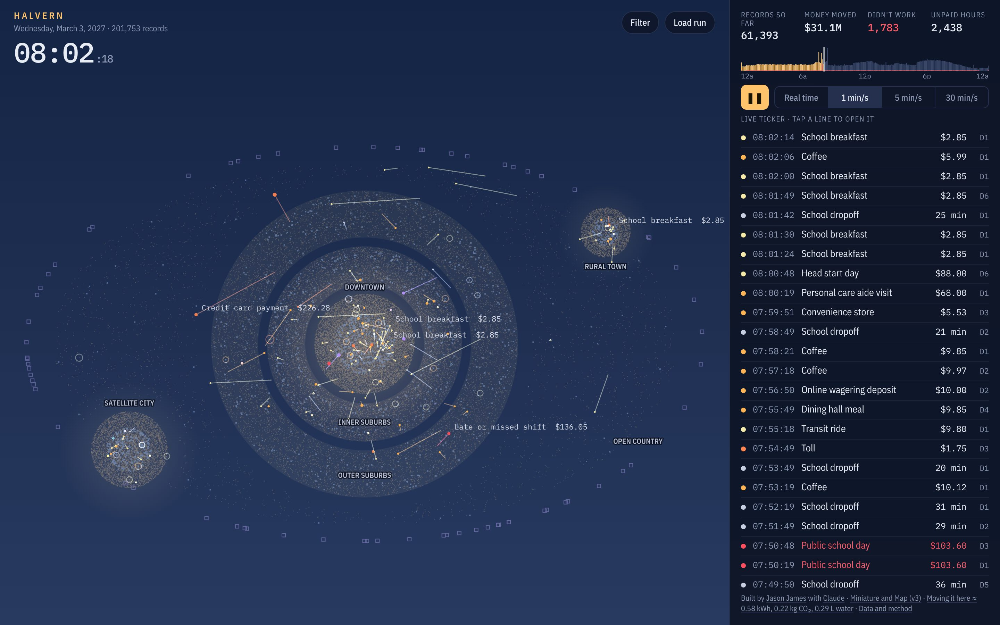
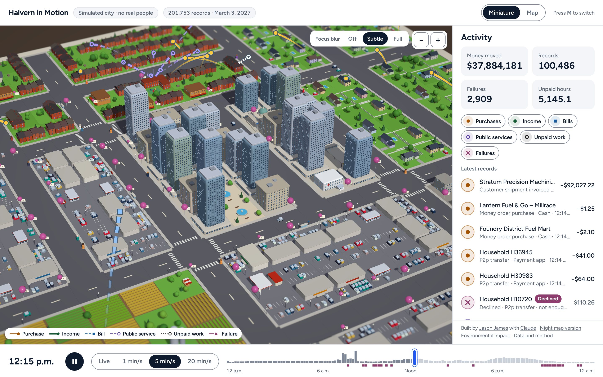

# The archive

Earlier versions of the Medianville viewer, kept as they shipped. They still play the first run of the day, [`data/halvern_2027-03-03.zip`](../data/halvern_2027-03-03.zip), from when the city was called Halvern. Each changed only in its relative paths and an "Archived version" link back to the latest.

New work lands in [the latest viewer](https://jas0nmjames.github.io/playground/mapping-synthetic-transactions/). How each version was made, and what came between them, is in [the story](../story/). The archive also has [its own page](https://jas0nmjames.github.io/playground/mapping-synthetic-transactions/archive/).

| | Version | Milestone | Shipped | Release |
|---|---|---|---|---|
|  | **[The night map](m1-night-map/)** (v1, the first viewer). Every record of Wednesday, March 3, 2027 drawn as a light crossing an abstract map of the city's six districts, with a timeline, a live ticker and a sheet for each record. [Open it](https://jas0nmjames.github.io/playground/mapping-synthetic-transactions/archive/m1-night-map/). | [M1 One day](../story/01-one-day/) | 2026-11-17, [#54](https://github.com/jas0nmjames/playground/pull/54) | [`medianville-m1-one-day`](https://github.com/jas0nmjames/playground/releases/tag/medianville-m1-one-day) |
|  | **[Miniature and Map, as first shipped](m2-miniature-and-map/)** (v3). Two views of one small city: a tabletop 3D town and the same town as a printed topographic sheet, chosen from three visual directions prototyped in the Claude app. The latest viewer grew out of it. [Open it](https://jas0nmjames.github.io/playground/mapping-synthetic-transactions/archive/m2-miniature-and-map/). | [M2 Miniature and Map](../story/02-miniature-and-map/) | 2026-11-17, [#57](https://github.com/jas0nmjames/playground/pull/57) | [`medianville-m2-miniature-and-map`](https://github.com/jas0nmjames/playground/releases/tag/medianville-m2-miniature-and-map) |

No viewer v2 shipped: the second round was a set of visual-direction prototypes in the Claude app, and the chosen direction became v3.

The old addresses, `v1/` and `v3/`, redirect here. The releases are snapshots of the project folder at the commit where each milestone ended; they're published from [`tools/github_milestones.sh`](../tools/github_milestones.sh).
