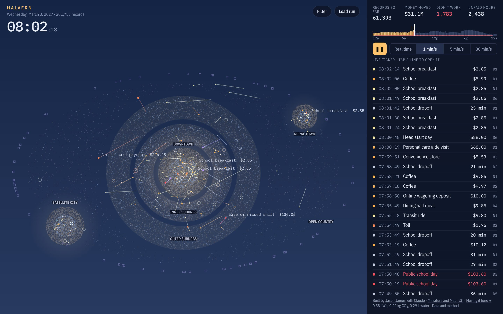

# The night map (M1 One day)

The first viewer of Medianville, then called Halvern: every record of one simulated day, Wednesday, March 3, 2027, drawn as a light crossing an abstract map of the city's six districts. It shipped on 2026-11-17 in [pull request #54](https://github.com/jas0nmjames/playground/pull/54) and stayed at the folder root, with v3 beside it in `v3/` from that evening, until the latest viewer took the root on 2026-11-20.

**Open it:** [archive/m1-night-map/](https://jas0nmjames.github.io/playground/mapping-synthetic-transactions/archive/m1-night-map/). The old address, `v1/`, redirects here. The [latest viewer](https://jas0nmjames.github.io/playground/mapping-synthetic-transactions/) is where new work lands, and the [story of M1](../../story/01-one-day/) tells how this one was made.

**Frozen as shipped.** This copy was taken at commit `0881c42` (2026-11-19) and moved to `v1/` when the latest viewer took the folder root on 2026-11-20, then here on 2026-11-24. Only its relative paths changed (one level deeper each time), plus an "Archived version" link back to the latest. It keeps the name Halvern and loads the v1 run under that name, [`data/halvern_2027-03-03.zip`](../../data/halvern_2027-03-03.zip). Release: [`medianville-m1-one-day`](https://github.com/jas0nmjames/playground/releases/tag/medianville-m1-one-day), the folder as first shipped at `2379e72`. This copy is that page plus five lines from the next two pull requests: [#57](https://github.com/jas0nmjames/playground/pull/57)'s fixes to the failure count, money moved, garbled names and job names, with a footer link to v3, and [#60](https://github.com/jas0nmjames/playground/pull/60)'s footer link to the systems lens.

8:02 a.m., playing at one minute a second.

| | The night map |
|---|---|
| Look | Dark, full-screen night sky; districts as glowing rings and clusters |
| City | The run's six districts, D1–D6, laid out as abstract shapes |
| Record kinds | 13 colors, one per record type |
| Needs | Any modern browser |

Its footer links to the latest viewer, to [Miniature and Map as first shipped](../m2-miniature-and-map/) and to the systems lens.

## Watching it

Placeholder records move while the real day downloads (16 MB), and then the clock starts at 6:30 a.m.

- **Clock and timeline.** Play or pause with the button or the space bar. Pick a speed from real time up to 30 minutes per second, and drag the timeline to jump. The bars show how busy each five minutes is, with failures in red.
- **Map.** The six districts are drawn as rings and clusters: downtown in the middle, inner and outer suburbs around it, and the satellite city, rural town and open country outside. Dots are households, squares are outside parties such as the Treasury, and the color of each light is the kind of record.
- **Records.** Tap a light or a line in the ticker to open the record: the job statement ("When…, I want to…, so I can…"), who paid, who else paid, the cost to the public, time, travel, frictions and outcome. From there you can show the household's whole day, follow it on the map, or open the attempt a retry links back to.
- **Filter.** Narrow the map by kind of record, district, friction or failure, the 500 hand-written records (marked ✎), or a word in the job name.
- **Load run.** Loads another run from your computer: a zip from the simulator, or `records.csv` with `organizations.csv`, `households.csv` and `persons.csv`.

## How it works

The page reads the CSVs directly as bytes, without turning every row into an object, so 201,753 records load in a few seconds. Each household and organization gets a fixed spot inside its district from a hash of its id, so the same entity always lands in the same place. As the clock advances, the page releases the records due by that time. It animates a sample of them along curved paths (up to 26 a frame on wide screens, 9 on phones), and the four counters stay exact. Records whose two ends are the same place, such as a school day, show as a ring that pulses outward instead.

Changes since the Claude artifact it came from:

- It loads [`data/halvern_2027-03-03.zip`](../../data/halvern_2027-03-03.zip) by itself on open, instead of asking for the file. If the download fails, it says so and falls back to the placeholder day and the Load run button.
- The placeholder day finishes building before the real one starts, so the two builds never share lookup tables.
- On narrow screens, floating captions stay inside the map.
- "Didn't work" now counts what the run's summary counts as a failure: every failed attempt, plus anything declined, abandoned, failed or rescheduled. It used to count "partial" outcomes too, which made it 8,726 by midnight instead of 6,896. "Money moved" leaves out failed records.
- Short names with characters such as the en dash in "Marlow's Market – Downtown" no longer come out garbled.
- Job names drop their group prefix ("Coffee", not "Food.coffee"), as in v3.
- A footer credits the page, links to the latest viewer and v3, and gives the impact figure in the [project README](../../README.md#claude).

