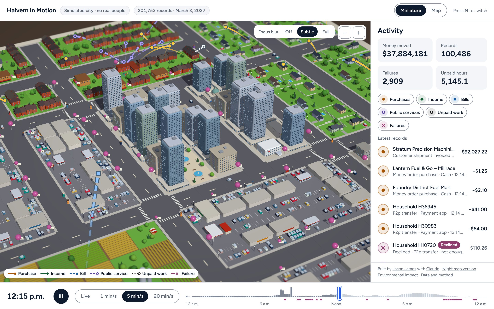
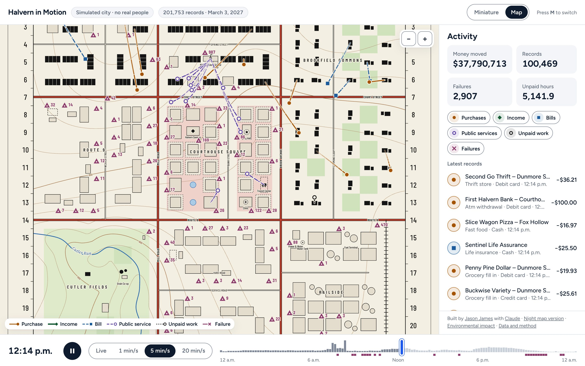

# Miniature and Map as first shipped (M2)

v3 of the viewer, as it shipped on 2026-11-17 in [pull request #57](https://github.com/jas0nmjames/playground/pull/57): two views of one small city. **Miniature** is a tabletop 3D model of the town; **Map** is the same town drawn as a printed topographic sheet (press **M** to switch). It was built as a Claude artifact around its own placeholder day, and `real-day.js` swapped in the real run: Wednesday, March 3, 2027, 201,753 records, when the city was still called Halvern.

**Open it:** [archive/m2-miniature-and-map/](https://jas0nmjames.github.io/playground/mapping-synthetic-transactions/archive/m2-miniature-and-map/). The old address, `v3/`, redirects here. The [latest viewer](https://jas0nmjames.github.io/playground/mapping-synthetic-transactions/) grew out of this one, and the [story of M2](../../story/02-miniature-and-map/) tells how it was chosen.

**Frozen as shipped.** This copy was taken at commit `0881c42` (2026-11-19), which differs from the release, [`medianville-m2-miniature-and-map`](https://github.com/jas0nmjames/playground/releases/tag/medianville-m2-miniature-and-map) at `9e0865e`, only in a one-line footer link to the systems lens. It moved to `v3/` beside the latest viewer on 2026-11-20 and here on 2026-11-24. Only its relative paths changed (one level deeper each time), plus an "Archived version" link back to the latest. It keeps the name Halvern and loads [`data/halvern_2027-03-03.zip`](../../data/halvern_2027-03-03.zip).

The two views as taken for the pull request on 2026-11-17, playing at five minutes a second.

| | Miniature and Map, as first shipped |
|---|---|
| Look | Light; a tabletop 3D town, or the same town as a printed topographic sheet |
| City | v3's own small town; the run's districts and places are folded onto its homes and buildings |
| Record kinds | 6 kinds with their own color, line and head: purchase, income, bill, public service, unpaid work, failure |
| Needs | WebGL, plus three.js from a CDN (falls back to the map without it) |

Its footer links to the latest viewer, to [the first viewer](../m1-night-map/) and to the systems lens.

**How it puts the real day on its town.** The fold of the run's six districts onto v3's homes and buildings, the sixth record kind for public services, the path budget, the place-only failure pins and the memory figures are all still how the latest viewer works, so they're described in the project README: [How the Miniature and Map use the real day](../../README.md#how-the-miniature-and-map-use-the-real-day-since-v3). What the latest viewer added since (photographic light, turning and tilting, sound, the systems lens over the city, the day menu) is in [M4](../../story/04-the-refined-city/) and [M5](../../story/05-more-time/).
