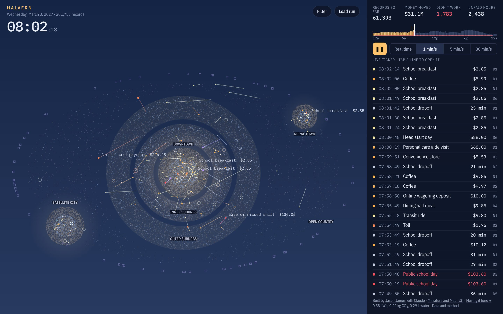

# M1 One day

## When

2026-11-16 to 2026-11-17. The day was generated in the Claude app on Nov 16; it came into the repo with the first viewer on Nov 17 in [#54](https://github.com/jas0nmjames/playground/pull/54), merged at [`2379e72`](https://github.com/jas0nmjames/playground/commit/2379e72). [GitHub milestone](https://github.com/jas0nmjames/playground/issues?q=milestone%3A%22Medianville+%C2%B7+M1+One+day%22) · [release `medianville-m1-one-day`](https://github.com/jas0nmjames/playground/releases/tag/medianville-m1-one-day).

## What I wanted

With Fable 5.2 newly released, I wanted to try a less common use of it from a design perspective. Instead of generating a richer and richer interface, I wanted to generate the transactions themselves: an unorthodox idea, a representative city's financial life that we could get real insight from.

## What I asked for

- [The transaction generator prompt](medianville-transaction-generator-prompt.md), run in GENERATOR mode with seed 20270303: "This dataset will be mined for small, practical projects that improve daily life at the margins."
- To add: the prompt for the first viewer's artifact in the Claude app, copied word for word into `prompts/`.

## What came back

- **The day:** Wednesday, March 3, 2027, in 201,753 records, from 41,400 households, 99,694 people and 1,672 organizations, in `halvern_2027-03-03.zip` (16 MB), with the simulator that made it and the 500 hand-written records. The [run record](medianville-2027-03-03-run-record.md) says how close it came to each anchor; [how the day was built](medianville-build-approach.md) gives the method, what close reading caught, and what was left unfixed.
- **The first viewer:** the night map, every record as a light crossing an abstract map of the six districts. It's kept in the [archive](../../archive/m1-night-map/), with how it works.

## What I decided, and roads not taken

- [2.1 Simulate, don't write](../decisions.md#21-simulate-dont-write): no one, human or model, can write 200,000 consistent records by hand. Code writes the day; the model wrote 500 records by hand.
- [2.2 Settle the day in time order](../decisions.md#22-settle-the-day-in-time-order-against-real-wallets), [2.3 Calibrate to published anchors](../decisions.md#23-calibrate-to-published-anchors-and-label-every-estimate), [2.4 Real federal names, invented local ones](../decisions.md#24-real-federal-names-invented-local-ones).
- [2.5 Freeze the simulator before hand-writing](../decisions.md#25-freeze-the-simulator-before-hand-writing), [2.6 Read a sample closely, as a test](../decisions.md#26-read-a-sample-closely-as-a-test), [2.7 Keep real and synthetic apart](../decisions.md#27-keep-real-and-synthetic-apart).
- [3.8 The real day preloaded](../decisions.md#38-the-real-day-preloaded): the page loads the run on its own, with no upload step.
- Not taken: BATCH mode, where the model writes records a few households at a time; it was the prompt's fallback if code couldn't run.

## Who did what

**Jason James:** the question, the specification and its anchors, and the direction for the viewer. **Claude:** Claude Fable 5.2 wrote the simulator, generated the day and hand-wrote the 500 records in one long session in the Claude app; Claude built the night map as an artifact there; and a Claude Code session moved it into this repo, made it load the run on its own and tested it.

## What it set up next

One day to look at. [M2](../02-miniature-and-map/) looked for a better way to see it, and [M3](../03-grounding-in-evidence/) asked whether it was true.
