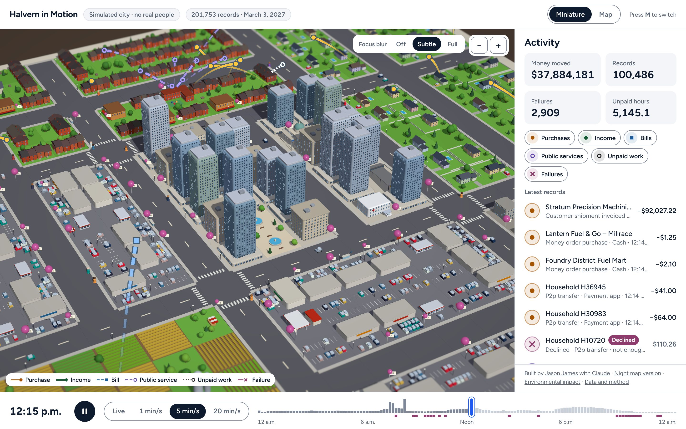
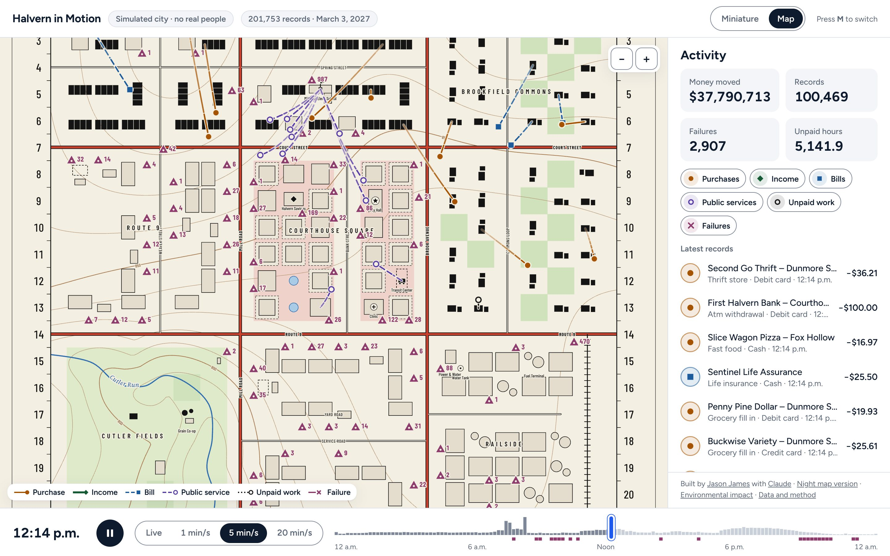

# M2 Miniature and Map

## When

2026-11-17. The visual directions were prototyped in the Claude app; v3 came into the repo in [#57](https://github.com/jas0nmjames/playground/pull/57), merged at [`9e0865e`](https://github.com/jas0nmjames/playground/commit/9e0865e). [GitHub milestone](https://github.com/jas0nmjames/playground/issues?q=milestone%3A%22Medianville+%C2%B7+M2+Miniature+and+Map%22) · [release `medianville-m2-miniature-and-map`](https://github.com/jas0nmjames/playground/releases/tag/medianville-m2-miniature-and-map).

## What I wanted

TODO(Jason): what the night map couldn't show you, and what you wanted to see instead.

## What I asked for

- To add: the visual-direction prompt, the three briefs (Tiles, Tabletop, Six Streets) and the prototypes' notes, copied word for word into `prompts/`.
- To add: the two-views prompt that turned Tabletop into Miniature and Map, copied word for word into `prompts/`.

## What came back

- **Three directions, prototyped:** Tiles, an isometric pixel city; Tabletop, a tilt-shift miniature; and Six Streets, a cut-paper cross-section. Tabletop was chosen.
- **v3, Miniature and Map:** two views of one city, sharing records, filters and selection, with one record language across both. `real-day.js` folded the run's six districts onto v3's own town. It's kept in the [archive](../../archive/m2-miniature-and-map/).

## What I decided, and roads not taken

- [3.1 Three visual directions, prototyped, then Tabletop](../decisions.md#31-three-visual-directions-prototyped-then-tabletop): not taken, Tiles and Six Streets, though Tabletop borrowed Tiles' range of buildings.
- [3.2 Two views of one city](../decisions.md#32-two-views-of-one-city-miniature-and-map), [3.3 One record language](../decisions.md#33-one-record-language-across-both-views), [3.4 Failures are never sampled](../decisions.md#34-failures-are-never-sampled), [3.5 A finance-app interface](../decisions.md#35-a-finance-app-interface).
- **No viewer v2 shipped.** The second round was the prototypes in the Claude app, and the chosen direction became v3.

## Who did what

**Jason James:** the visual direction, the choice of Tabletop and the two views. **Claude:** wrote the briefs and built the prototypes and v3 as artifacts in the Claude app, under Jason's direction; a Claude Code session put v3 on the real day (`real-day.js`, the public-service kind, the path budget, place-only pins) and opened the pull request.

## What it set up next

The viewer that every later milestone built on: [M4](../04-the-refined-city/) gave it light, sound and the systems lens, and moved it to the folder root.
