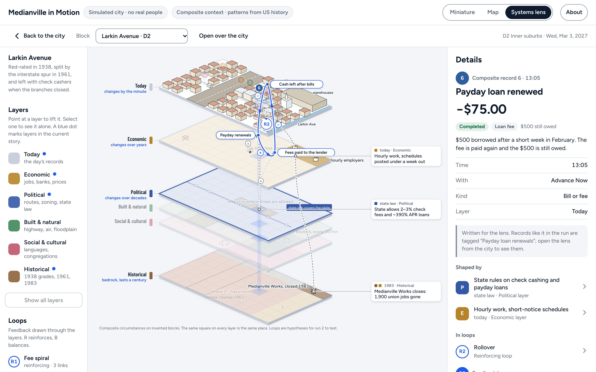
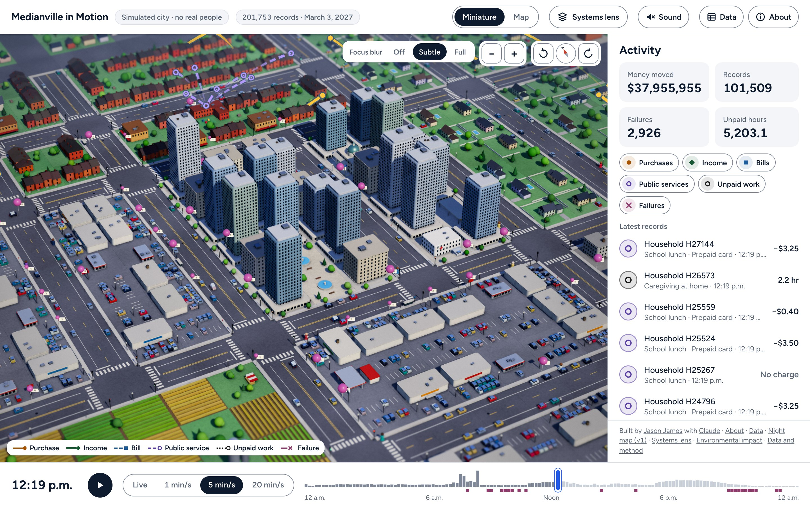

# M4 The refined city

## When

2026-11-18 to 2026-11-20, in [#60](https://github.com/jas0nmjames/playground/pull/60), [#63](https://github.com/jas0nmjames/playground/pull/63), [#64](https://github.com/jas0nmjames/playground/pull/64), [#66](https://github.com/jas0nmjames/playground/pull/66), [#67](https://github.com/jas0nmjames/playground/pull/67), [#68](https://github.com/jas0nmjames/playground/pull/68), [#69](https://github.com/jas0nmjames/playground/pull/69), [#72](https://github.com/jas0nmjames/playground/pull/72) and [#77](https://github.com/jas0nmjames/playground/pull/77), the rename, merged at [`7013a0f`](https://github.com/jas0nmjames/playground/commit/7013a0f). It ran beside [M3](../03-grounding-in-evidence/). [GitHub milestone](https://github.com/jas0nmjames/playground/issues?q=milestone%3A%22Medianville+%C2%B7+M4+The+refined+city%22) · [release `medianville-m4-the-refined-city`](https://github.com/jas0nmjames/playground/releases/tag/medianville-m4-the-refined-city).

## What I wanted

I didn't want a narrow view of a financial transaction. A person is trying to accomplish a goal, and I wanted to show how systems, society and history affect it. That brings my humanities background to a financial industry problem. The data tables and clear documentation help make it feel real.

## What I asked for

- To add: the systems lens prompts and the lens prototype notes, copied word for word into `prompts/`.
- To add: the mapped-blocks notes, the realism lab and the sound lab briefs, copied word for word into `prompts/`.
- To add: the briefs for the data explorer, the viewer reorganization, the intro and About page, and the rename.

## What came back

- **The systems lens** ([design record](medianville-systems-lens.md)): standalone first ([#60](https://github.com/jas0nmjames/playground/pull/60)), then an overlay that grows out of a record's details ([#63](https://github.com/jas0nmjames/playground/pull/63)), on one mapped block per district with the run's records tagged to them ([#64](https://github.com/jas0nmjames/playground/pull/64)).
- **A photographic miniature** ([realism record](medianville-miniature-realism.md), [#66](https://github.com/jas0nmjames/playground/pull/66)): sun and sky, filmic tone, contact shadows, night lights, street detail, the land past the board, turning and tilting.
- **Sound**, Mix A from the sound lab ([#68](https://github.com/jas0nmjames/playground/pull/68)), and **the data explorer** ([#67](https://github.com/jas0nmjames/playground/pull/67); [screenshot](explorer.jpg)).
- **The repo reorganized** ([#69](https://github.com/jas0nmjames/playground/pull/69)): the latest viewer at the folder root, the first viewer and v3 frozen beside it.
- **An intro and an About page** ([#72](https://github.com/jas0nmjames/playground/pull/72); [intro](intro-desktop.jpg), [on a phone](intro-phone.jpg), [About](about-desktop.jpg), [About on a phone](about-phone.jpg)), and **the rename** from Halvern to Medianville ([#77](https://github.com/jas0nmjames/playground/pull/77)), with a renamed copy of the v1 run for the latest pages.

## What I decided, and roads not taken

- The lens: [4.1 Exploded view](../decisions.md#41-exploded-view-the-works-and-section-dropped). Dropped: **The Works**, which drew one household as plumbing, tying an abstract model to pipes the city doesn't have, and the Section view, folded into the exploded one. [4.2 "What if" waits for real model runs](../decisions.md#42-what-if-waits-for-real-model-runs): no button to remove a circumstance until circumstances drive the simulator. [4.3](../decisions.md#43-one-visual-system-with-biesty-in-the-structure-only), [4.4](../decisions.md#44-the-lens-as-an-overlay-on-the-city) (not taken: the lens as a third view), [4.5](../decisions.md#45-one-mapped-block-per-district-from-one-file).
- The miniature: [3.6 A photographic miniature, without lens blur](../decisions.md#36-a-photographic-miniature-without-lens-blur). Dropped: the tilted-plane lens blur. [3.7 Sound: off by default, Mix A](../decisions.md#37-sound-off-by-default-mix-a).
- The repo: [5.1](../decisions.md#51-a-separate-data-explorer), [5.2](../decisions.md#52-latest-viewer-at-the-root-archives-frozen), [5.3](../decisions.md#53-design-labs-stay-in-the-project); the name: [1.5](../decisions.md#15-the-name-medianville), [1.6](../decisions.md#16-a-renamed-copy-of-v1-for-the-latest-pages); explaining it: [6.1 to 6.5](../decisions.md#6-explaining-the-project-2026-11-20).
- A dead end left for later: about 93% of records had no mapped block, so their **What shaped this** was a disabled row. [M5](../05-more-time/)'s district tier removed it.

## Who did what

**Jason James:** the systems lens and its directions, the realism references, the sound mix, the name, and the shape of the intro and About page. **Claude:** built the lens, the labs, the explorer and the intro and About page in the Claude app and in Claude Code, mapped the blocks and tagged the run, and did the rename across the simulator, pages and docs, checking every output byte for byte.

## What it set up next

The viewer as it stands today, ready for more than one day: [M5](../05-more-time/) gave it the day menu.
