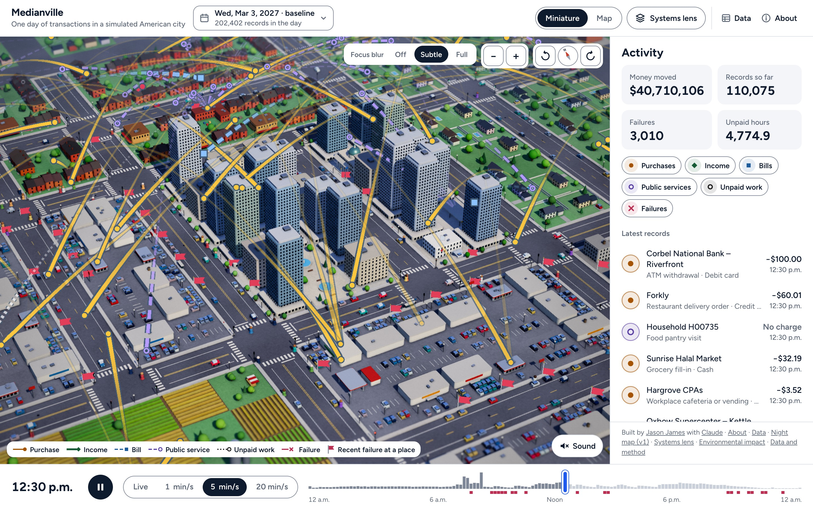

# M6 Refinements (ongoing)

## When

From 2026-11-21, in [#83](https://github.com/jas0nmjames/playground/pull/83), [#85](https://github.com/jas0nmjames/playground/pull/85), [#138](https://github.com/jas0nmjames/playground/pull/138) and [#139](https://github.com/jas0nmjames/playground/pull/139), the commits pushed straight to `development` on Nov 23, and the milestones and archive work of Nov 24. Still open. [GitHub milestone](https://github.com/jas0nmjames/playground/issues?q=milestone%3A%22Medianville+%C2%B7+M6+Refinements%22). No release yet.

## What I asked for

- To add: Jason's list of adjustments for the polish pass and the design critique behind the Nov 23 changes, copied word for word into `prompts/`.
- [The public sharing pass](prompts/public-sharing-pass.md) (Nov 25): a shorter intro, the features explained in the project README with GIFs and "Try it" links, a site that describes only work done to date, and Jason's words on why he made it.

## What came back

The screenshots in this folder are the ones the [project README](../../README.md) showed from Nov 23 to Nov 25: [Map](v3-map.jpg), [systems lens](systems-lens.jpg), [explorer](explorer.jpg), [intro](intro-desktop.jpg) and [intro on a phone](intro-phone.jpg), as retaken on Nov 23. Since the public sharing pass the README shows seven GIFs in [`readme-media/`](../../readme-media/) instead, retaken by `tools/capture_readme_gifs.mjs`.

## Running log

| Date | Where | What |
|---|---|---|
| 2026-11-21 | [#83](https://github.com/jas0nmjames/playground/pull/83) | The viewer falls back to the Map when WebGL can't start |
| 2026-11-22 | [#85](https://github.com/jas0nmjames/playground/pull/85) | Polish pass: Live by default, the new title and subtitle, "Sample day", turning while paused; the map sheet restyled; the compact header and phone layout |
| 2026-11-23 | [`63c8731`](https://github.com/jas0nmjames/playground/commit/63c8731), [`384a19f`](https://github.com/jas0nmjames/playground/commit/384a19f) | Miniature: lighter frames on big windows and slower GPUs; the horizontal stripes on the ground fixed |
| 2026-11-23 | [`46851e2`](https://github.com/jas0nmjames/playground/commit/46851e2) | Failure flags that come down, end marks that linger, crimson failures, an Activity feed that holds still |
| 2026-11-23 | [`9ccbd7a`](https://github.com/jas0nmjames/playground/commit/9ccbd7a), [`a49d14c`](https://github.com/jas0nmjames/playground/commit/a49d14c) | A Key button for the legend on phones; one day control; Sound on the city; smaller fixes |
| 2026-11-23 | [`d08935d`](https://github.com/jas0nmjames/playground/commit/d08935d), [`175551d`](https://github.com/jas0nmjames/playground/commit/175551d), [`8275a2e`](https://github.com/jas0nmjames/playground/commit/8275a2e) | The README screenshots retaken; the explorer's header on one row, with labels hyphenated like the viewer |
| 2026-11-24 | This milestone's pull request | The milestones, the story and the archive; the first viewer taken off the live pages |
| 2026-11-25 | [#138](https://github.com/jas0nmjames/playground/pull/138) | A shorter intro; the README rewritten around the features, with seven GIFs and "Try it" links; `#record=` and `#household=` links in the viewer; the site and the agent files describe only work done to date; Jason's words in each milestone |
| 2026-11-25 | [#139](https://github.com/jas0nmjames/playground/pull/139) | The systems lens keeps its three columns on laptops: in the viewer at 1280 × 800 and 1366 × 768 all six layers are in view; the lens GIF lifts all six |
| 2026-11-26 | This pull request | The Miniature's fidelity pass, first part of look 4: walking legs, trees in the wind, softer contact shadows and cloud shadows |

The Nov 23 commits went straight to `development`, so they can't be filed under a GitHub milestone; they're listed in its description. [`fae067f`](https://github.com/jas0nmjames/playground/commit/fae067f), pushed among them, is the playground's directory website, not Medianville. From here on, Medianville work goes through a pull request so it can be filed.

## What I decided, and roads not taken

- [3.9 End marks that linger, and failure flags that come down](../decisions.md#39-end-marks-that-linger-and-small-failure-flags-that-come-down), [3.10 Failure is crimson everywhere](../decisions.md#310-failure-is-crimson-everywhere), [3.11 The Activity feed holds still](../decisions.md#311-the-activity-feed-holds-still-while-you-use-it).
- [4.7 Layer colours in two lightness tiers](../decisions.md#47-layer-colours-in-two-lightness-tiers), still waiting for Jason's review.
- The polish pass, [7.1 to 7.11](../decisions.md#7-polish-pass-2026-11-22).
- The public sharing pass: [6.6 A shorter intro](../decisions.md#66-a-shorter-intro-with-a-one-line-credit), [6.7 Features explained in the README, with GIFs](../decisions.md#67-features-explained-in-the-readme-with-gifs) and [6.8 The site describes only work done to date](../decisions.md#68-the-site-describes-only-work-done-to-date). Not taken: a welcome wizard inside the viewer.

## Who did what

**Jason James:** the list of adjustments, the design critique, and the public sharing brief with its intro copy, README text and his own words for each milestone. **Claude:** made them in Claude Code, checking each in the browser at phone, tablet and desktop widths, retook the screenshots, and wrote the GIF script and took the GIFs.

## What it set up next

A city that's ready to be mined: [Next](../next-mining-for-projects/).
