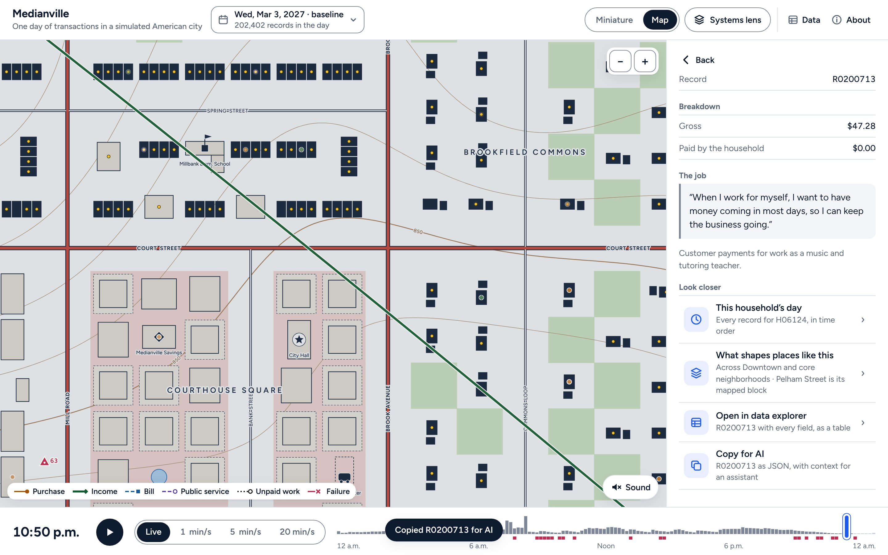

# M7 Open to agents (ongoing)

## When

From 2026-11-24. The first pass is this milestone's first pull request, into `development`. Still open: the rest of M7 is listed under [What it set up next](#what-it-set-up-next). No release yet.

## What I wanted

TODO(Jason): why open the city to agents and LLMs now, and what an agent should be able to do with it.

## What I asked for

- The first pass: make the live site readable by agents and LLMs with static files only, no server, no new dependencies. The brief is copied word for word in [`prompts/agent-readable-first-pass.md`](prompts/agent-readable-first-pass.md).

## What came back

A record's **Copy for AI** in the viewer, just pressed.

- **`llms.txt`**, written by hand: what Medianville is, the note for agents to say once at the start of a session (synthetic, grounded in real research, Jason James's project), how to cite it, and links to everything below. Live at [medianville.netlify.app/llms.txt](https://medianville.netlify.app/llms.txt) once `main` has it.
- **[`agents/`](../../agents/)**, written by [`tools/build_agent_pages.py`](../../tools/build_agent_pages.py) from the repo's own files: the About page as Markdown, a data dictionary for every column of every table (each meaning with its source, and the columns nothing describes marked *undocumented*), the runs, each run's own README and summary, the six districts with their circumstances and loops (marked composite), and the March month. [`llms-full.txt`](../../llms-full.txt) is all of it in one file. Every page starts with a one-line header that points back to `llms.txt` and stays under about 8,000 tokens; the districts were split into a page each to fit.
- **Head tags** on the viewer, the explorer, the systems lens, About and the archive: a description, a canonical link, a link to `llms.txt`, and Open Graph title and description. About also carries a schema.org Dataset in JSON-LD, with the 20 day zips as downloads on GitHub.
- **Licenses**: [`LICENSE-DATA`](../../LICENSE-DATA) (CC BY 4.0 for the data, documents and images; the code stays MPL-2.0; `evidence/` under neither) and [`CITATION.cff`](../../CITATION.cff).
- **[`robots.txt`](../../robots.txt)** welcomes every crawler and agent except on the zips, and **[`_headers`](../../_headers)** serves the agent files as Markdown and caches `data/` for a day.
- **Copy for AI** on a record, in the viewer and the explorer: the record as JSON, with a line saying it's synthetic, where its context is, and three starter questions.
- **Checks**: [`sim/tests/test_agent_pages.py`](../../sim/tests/test_agent_pages.py) fails when a page is stale, a header is missing, a file runs over the size limit, or a link into the site or the repo doesn't resolve, and checks the JSON-LD, `robots.txt` and `_headers`. [`tools/check_links.py`](../../tools/check_links.py) now follows links to the Netlify site and to raw files on GitHub.

## What I decided, and roads not taken

- [8.1 Agents bring their own compute](../decisions.md#81-agents-bring-their-own-compute) (not taken: a hosted MCP server or API).
- [8.2 Provenance once per session](../decisions.md#82-provenance-once-per-session) (not taken: the note in every answer).
- [8.3 A readable layer before any protocol](../decisions.md#83-a-readable-layer-before-any-protocol).
- [8.4 Licenses](../decisions.md#84-licenses) (not taken: CC BY-SA, CC BY-NC or CC0 for the data, MIT for the code).
- [8.5 Bulk downloads on GitHub, crawlers kept off the zips](../decisions.md#85-bulk-downloads-on-github-crawlers-kept-off-the-zips).

## Who did what

**Jason James:** the principles, the licenses, the draft of `llms.txt` and the brief. **Claude:** in Claude Code, wrote the generator and its pages, the data dictionary from the simulator's code and the run records, `llms.txt` from Jason's draft, the licenses, metadata and button, and checked it all in headless Chrome at desktop and phone widths.

## What it set up next

The rest of M7, built on these pages: Parquet files and a Hugging Face dataset, the viewers loading their data off Netlify, a local MCP server, "Open in Claude" and "Open in ChatGPT" links, and an eval set. After `main` has this pass, Jason checks it with an agent by hand.
